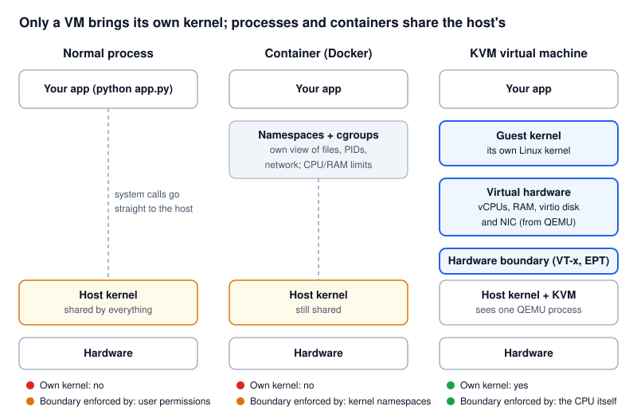
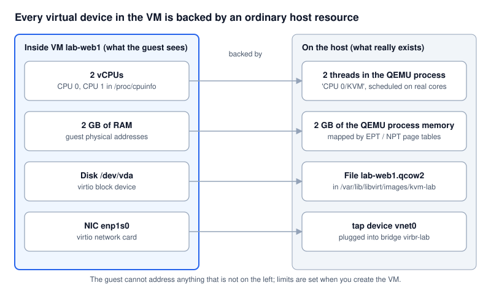
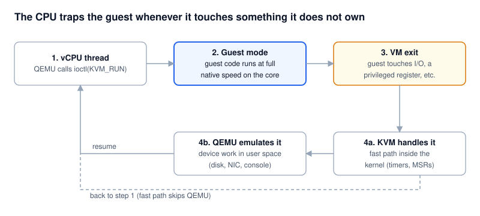
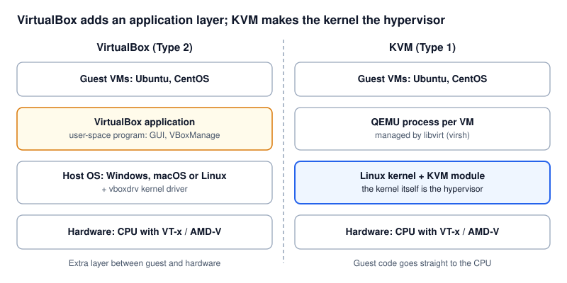

# How a KVM virtual machine works

A KVM VM is an ordinary Linux process that the CPU itself keeps inside walls.
This page explains each wall and shows you how to see it on a running lab VM.
Back to the [README](../README.md).

```bash
./kvm-lab.sh create web1
./kvm-lab.sh inspect web1
```

---

## 1. One VM = one process

```bash
ps -o pid,user,%cpu,rss,comm -C qemu-system-x86_64
#  PID USER          %CPU   RSS COMMAND
# 4182 libvirt-qemu   3.1 812344 qemu-system-x86
```

That process is the whole VM: its CPUs, its memory and its devices. Killing it
(`virsh destroy`) is like pulling the power cord. Unlike a normal process, the
code that does the real work is **not** host code: it is a complete guest
operating system with its own kernel, running on a virtual machine that QEMU and
KVM present to it.



| Question | Normal process | Container | KVM VM |
| --- | --- | --- | --- |
| Whose kernel runs its system calls? | Host | Host | Guest's own |
| How does it reach the host? | System calls | System calls (filtered by namespaces, seccomp) | It cannot make host system calls; it only touches virtual hardware |
| Who stops it reading other memory? | Host kernel page tables | Host kernel page tables | CPU second-level page tables (EPT/NPT) |
| Can it load kernel modules? | Into the host (if root) | Into the host (if privileged) | Only into its own guest kernel |
| Kernel panic hurts | The host | The host | Only that VM |

---

## 2. CPU: vCPU threads and guest mode



- Each vCPU is a thread of the QEMU process. With libvirt the threads are named
  `CPU 0/KVM`, `CPU 1/KVM`, ...: `ps -T -p <pid> -o spid,comm,psr`.
- The thread calls `ioctl(fd, KVM_RUN)` on `/dev/kvm`. KVM then asks the CPU for a
  **VM entry**: the core switches to *guest mode* (Intel "VMX non-root",
  AMD "SVM guest") and runs the guest's instructions natively. No emulation, no
  translation, which is why KVM is close to bare-metal speed.
- The host scheduler sees an ordinary thread. It can preempt it, move it between
  cores, or pin it: `virsh vcpupin lab-web1 0 2` (vCPU 0 on core 2).
- The guest can never get more CPU than its vCPU count, and `virsh schedinfo
  lab-web1 --set cpu_shares=512` weights it against other VMs.

### VM exits: the CPU traps the guest



When the guest does something that would affect the real machine, the CPU stops
it and performs a **VM exit** back to KVM, recording why. Typical reasons:

| Guest does | Exit handled by | Result |
| --- | --- | --- |
| Reads/writes a virtio device queue doorbell | KVM, then QEMU (or vhost in the kernel) | Disk or network I/O is done on the host's behalf |
| Touches an emulated device register (serial console, old IDE) | QEMU | Device behaviour emulated in user space |
| Uses the timer / interrupt controller | KVM (in kernel) | Fast path, no QEMU involvement |
| Executes `HLT` (idle) | KVM | vCPU thread sleeps, host CPU is freed |
| Accesses memory it has no mapping for | KVM | Page mapped in from the QEMU process, or the access fails |

Then KVM performs a VM entry and the guest continues, unaware it was paused.

---

## 3. Memory: two levels of page tables

```
guest virtual address --(guest page tables, owned by guest kernel)--> guest "physical" address
guest "physical" address --(EPT / NPT, owned by KVM)----------------> host physical address
```

- The guest kernel manages its own page tables as on real hardware.
- The **second level** (Intel EPT, AMD NPT) is set by KVM and walked by the CPU
  on every access. It only contains the pages of that VM's RAM block inside the
  QEMU process. There is no guest address that maps to host kernel memory or to
  another VM.
- Guest RAM is allocated lazily: a 2 GB VM that has touched 600 MB costs about
  600 MB on the host (see `VmRSS` in `/proc/<pid>/status`). This allows
  **overcommit** (more VM RAM than host RAM), which is convenient but means an
  overcommitted host can swap or kill VMs.
- Related features: the **balloon** driver (`virsh setmem` lets the host take RAM
  back from a cooperating guest), **KSM** (merges identical pages across VMs),
  hugepages (faster for large VMs).

---

## 4. Devices: everything is a host object

| Guest sees | Host reality | Inspect |
| --- | --- | --- |
| Disk `/dev/vda` (virtio-blk) | A qcow2 file, e.g. `/var/lib/libvirt/images/kvm-lab/lab-web1.qcow2` | `virsh domblklist lab-web1` |
| NIC `enp1s0` (virtio-net) | A `tap` device (`vnet0`) on the virtual switch `virbr-lab` | `virsh domiflist lab-web1` |
| Serial console `ttyS0` | A pseudo-terminal on the host | `virsh console lab-web1` |
| `qemu-guest-agent` channel | A UNIX socket on the host | `virsh domifaddr lab-web1 --source agent` |

**Emulated vs virtio.** QEMU can imitate real hardware (an Intel e1000 card, an
IDE disk) so that any OS works, but every register access causes a VM exit.
**virtio** devices are designed for VMs: the guest puts requests in shared-memory
queues and rings a doorbell once per batch, so there are far fewer exits. Every
modern Linux has virtio drivers; the lab always uses them.

**Device passthrough** (giving a VM a real PCI device such as a GPU or NIC) uses
the **IOMMU** (Intel VT-d / AMD-Vi) so the device can only DMA into that VM's
memory. The lab does not use passthrough.

---

## 5. Walls around the QEMU process

KVM's hardware walls keep the *guest* in. These keep the *QEMU process* in, in
case a guest ever found a bug in QEMU:

| Wall | What it does | See it |
| --- | --- | --- |
| Unprivileged user | QEMU runs as `libvirt-qemu` (Ubuntu) or `qemu` (RHEL/Fedora) | `ps -o user -p <pid>` |
| sVirt (AppArmor on Ubuntu, SELinux on RHEL) | Each VM gets its own profile/label and may only open its own disks and sockets | `ps -Z -p <pid>`, `aa-status` |
| cgroups | Each VM in its own cgroup under `machine.slice`: CPU, memory, I/O limits | `systemd-cgls machine.slice` |
| Private mount namespace | QEMU sees only the device nodes it needs | `ls -l /proc/<pid>/ns/mnt` |
| Fixed definition | vCPUs, RAM, disks and NICs are set in the VM's XML; the guest cannot add hardware | `virsh dumpxml lab-web1` |

Limits you can set per VM:

```bash
virt-xml lab-web1 --edit --vcpus 4                    # vCPU count (VM off)
virt-xml lab-web1 --edit --memory 4096                # RAM in MiB (VM off)
virsh schedinfo lab-web1 --set cpu_shares=512         # CPU weight
virsh blkdeviotune lab-web1 vda --total-iops-sec 500  # disk I/O cap
virsh domiftune lab-web1 vnet0 --inbound 10000        # network cap (KB/s)
```

---

## 6. What isolation does not give you

- **Not absolute.** A bug in KVM or QEMU can, rarely, allow a guest to escape.
  Keep the host patched; the walls in section 5 limit the damage.
- **Shared physical resources.** VMs compete for the same cores, RAM bandwidth,
  disks and network. A noisy VM slows its neighbours unless you set limits.
- **Shared network.** Bridged VMs are on your real LAN and need the same
  firewalling as any server.
- **The host is all-powerful.** Root on the host can read every VM's disk and
  memory. Isolation protects the host from guests, not guests from the host.

---

## 7. VirtualBox does the same, in a different place

VirtualBox also uses VT-x/AMD-V and nested page tables, so a VirtualBox guest is
also trapped by the CPU. The difference is where the hypervisor lives: in
VirtualBox it is the `vboxdrv` driver plus the VirtualBox application on top of a
general host OS; in KVM it is part of the Linux kernel, and the host's normal
scheduler, memory manager, cgroups and security modules apply to VMs directly.


