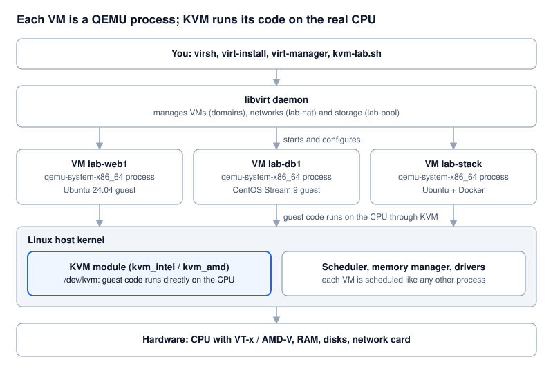
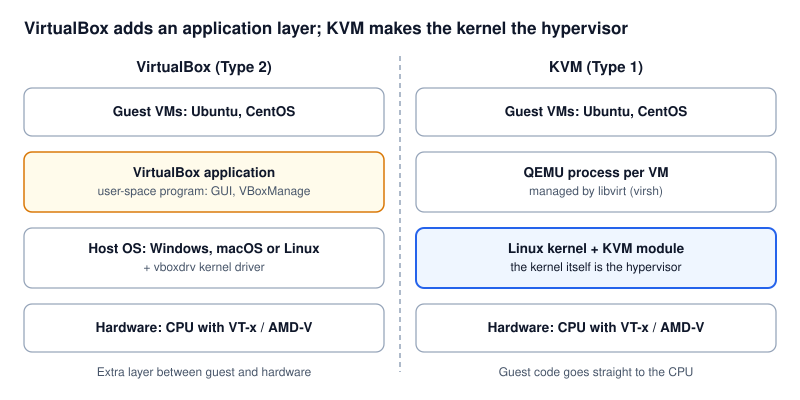
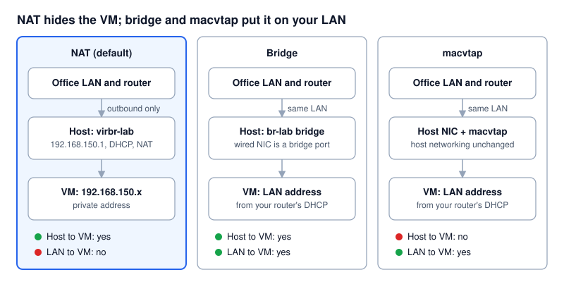
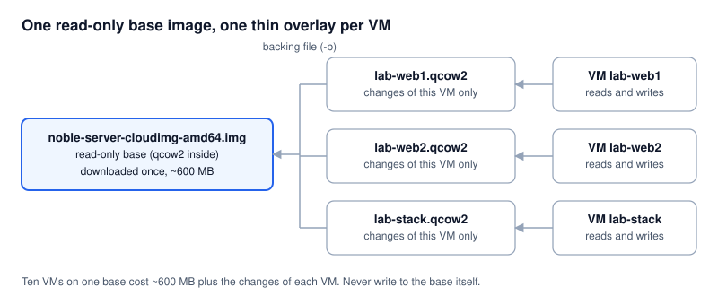
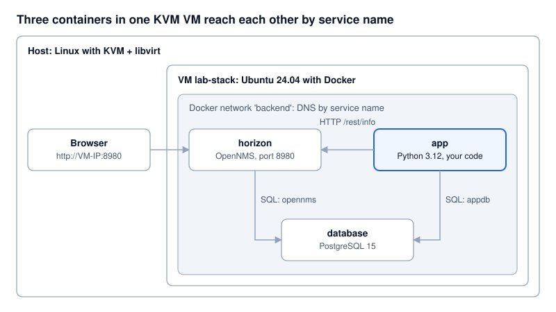
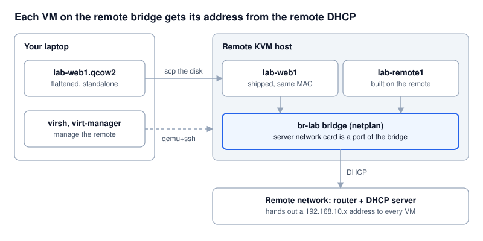

# KVM Lab: step-by-step manual guide

Type every command yourself and check each result. Back to the [README](../README.md); the scripted tutorial is in [TUTORIAL.md](TUTORIAL.md).

## How to use this guide

You build the whole lab by typing every command yourself, one at a time, and checking the result before moving on. Sections 1 to 3 explain the ideas; Steps 1 to 17 are the hands-on lab, from an empty Linux host to Ubuntu and CentOS VMs, containers, a bridged LAN and a remote KVM host.

**Every step has the same parts**

| Part | What it means |
| --- | --- |
| **Goal** | What you will have at the end of the step |
| Command block | Type the lines one by one. Lines starting with `#` are comments: read them, do not type them |
| **Check** | A command plus the output you should see. Do not continue until it matches |
| **What happened** | One or two sentences on what changed on your host |
| **Undo** | How to reverse only this step |
| **Script equivalent** | The `kvm-lab.sh` command that does the same thing automatically |

**Two ways to run the lab**

- **Manual (recommended for learning):** follow Steps 1 to 17 in order.
- **Scripted:** `./kvm-lab.sh tour` and `./kvm-lab.sh stack`, then `./kvm-cleanup.sh`. Use this to repeat the lab quickly.

You can mix them. The manual steps use exactly the same names (`lab-*`), directories and state files as the scripts, so `./kvm-cleanup.sh` also cleans up a lab you built by hand.

**Requirements:** an x86-64 Linux host (Ubuntu 22.04/24.04 or Debian 12 shown; Fedora/RHEL lines given where they differ), Intel VT-x or AMD-V enabled in BIOS, 8 GB RAM (16 GB for Step 14), 30 GB free disk, `sudo` rights and internet access. Step 15 needs a wired network card; Step 16 needs a second Linux machine you can reach over SSH.

**Keep one terminal open.** The settings from Step 1 live in that terminal. If you open a new one, run `source ~/kvm-lab/lab.env` first.

## 1. Introduction to KVM

KVM (Kernel-based Virtual Machine) is a module in the Linux kernel that turns Linux itself into a hypervisor. Each VM is an ordinary Linux process, so the kernel's scheduler, memory manager and drivers serve VMs directly.

You never use KVM alone. Four pieces work together:

| Piece | What it does | You touch it through |
| --- | --- | --- |
| **KVM** (kernel module `kvm_intel` / `kvm_amd`) | Runs guest CPU instructions directly on the physical CPU using VT-x / AMD-V | `/dev/kvm` |
| **QEMU** | Emulates the rest of the PC: disks, network cards, BIOS, serial console. One `qemu-system-x86_64` process per VM | `qemu-img` for disks |
| **libvirt** | Daemon that manages VMs, networks and storage pools, and stores each VM as an XML definition | `virsh`, `virt-install`, `virt-xml` |
| **virt-manager** (optional) | A desktop GUI, the closest thing to the VirtualBox window | `virt-manager` |



Read it bottom-up: the CPU's virtualisation extensions let the kernel's KVM module run guest code directly, QEMU supplies the virtual hardware, and libvirt is the manager you talk to.

**Example: what you will be able to do after this guide**

```bash
./kvm-lab.sh create web1 ubuntu24      # Ubuntu 24.04 VM, booted in ~30 s
sudo virsh -c qemu:///system list      # list running VMs
ps -ef | grep qemu-system              # each VM is just a process
./kvm-lab.sh ssh web1                  # log in
```

**Key words you will meet**

- **Domain** - libvirt's word for a VM. `virsh list` lists domains.
- **Guest / host** - the VM / the physical machine.
- **`qemu:///system`** - the system-wide libvirt daemon (VMs survive logout, real networking). The lab always uses it.
- **virtio** - paravirtual disk and network drivers. Much faster than emulated hardware; every modern Linux guest has them.
- **cloud-init** - a tool inside cloud images that configures the VM on first boot (user, SSH key, packages).

## 2. KVM vs VirtualBox

VirtualBox is an application with its own kernel driver, running on top of a host OS (Type 2). KVM is part of the Linux kernel, so the host OS *is* the hypervisor (usually called Type 1). In practice that means less overhead, no extra vendor kernel modules to rebuild after kernel updates, and the same tooling cloud providers use.



On the left a guest reaches the CPU through an application and a separate host OS; on the right the host kernel is the hypervisor and each VM is a QEMU process.

|  | VirtualBox | KVM + libvirt |
| --- | --- | --- |
| Hypervisor type | Type 2: app + `vboxdrv` driver on the host OS | Built into the Linux kernel (Type 1 in practice) |
| Host OS | Windows, macOS, Linux | Linux only |
| Typical use | Desktops, demos | Servers, clouds (OpenStack, Proxmox, oVirt), CI |
| Default disk format | `.vdi` | `.qcow2` (or raw `.img`) |
| Main CLI | `VBoxManage` | `virsh`, `virt-install`, `qemu-img` |
| GUI | VirtualBox Manager | virt-manager, Cockpit (web) |
| Headless server use | Possible, not its focus | The normal case |
| Licence | GPLv2 core; Extension Pack under a separate commercial licence | Fully open source (GPL/LGPL) |

**Same task, both tools**

| Task | VirtualBox | KVM |
| --- | --- | --- |
| List VMs | `VBoxManage list vms` | `virsh list --all` |
| Start / stop | `VBoxManage startvm web1 --type headless` / `controlvm web1 acpipowerbutton` | `virsh start web1` / `virsh shutdown web1` |
| Force off | `VBoxManage controlvm web1 poweroff` | `virsh destroy web1` (does not delete anything) |
| Snapshot | `VBoxManage snapshot web1 take s1` | `virsh snapshot-create-as web1 s1` |
| Show VM config | `VBoxManage showvminfo web1` | `virsh dumpxml web1` |
| Delete VM + disk | `VBoxManage unregistervm web1 --delete` | `virsh undefine web1 --remove-all-storage` |
| Convert disk | `VBoxManage clonemedium a.vdi b.vmdk` | `qemu-img convert -f vdi -O qcow2 a.vdi a.qcow2` |

**Moving an existing VirtualBox VM:** convert its disk with `qemu-img convert -p -f vdi -O qcow2 old.vdi old.qcow2`, copy it to `/var/lib/libvirt/images/`, then `virt-install --import --disk path=...`. For your OpenNMS/PostgreSQL setups it is usually cleaner to rebuild from a fresh cloud image and re-deploy the containers (Step 14); Step 16 shows how to ship a whole VM to another host.

**Do not run both at once.** VirtualBox and KVM both need exclusive use of VT-x. Shut down VirtualBox VMs before starting KVM VMs. `kvm-cleanup.sh` unloads the KVM modules so VirtualBox works again without a reboot.

## 3. Safety first: what can break, and the one-command undo

The lab is built so that `./kvm-cleanup.sh` returns the host to its original state. Only one step, the optional real bridge, touches your host's own network, and it has three safety nets.

**How the lab keeps itself sandboxed**

- Every VM, network and storage pool it creates is named `lab-*`. Cleanup deletes only those names.
- All VM disks live in one directory: `/var/lib/libvirt/images/kvm-lab`.
- All your files (SSH key, cloud-init files, scratch disks, state) live in `~/kvm-lab`. Your `~/.ssh` is never touched; SSH to VMs uses a lab-only key and does not write to `~/.ssh/known_hosts`.
- At install time it snapshots the package list before and after, and saves the exact list of new packages in `~/kvm-lab/state/packages-installed-by-lab.txt`. Cleanup removes only those.
- It uses its own NAT network `lab-nat` (192.168.150.0/24). Libvirt's `default` network and anything you already had are left alone.

**Risks and how each is handled**

| Risk | When | What the lab does |
| --- | --- | --- |
| Host loses network | `hostbridge on` only | Refuses on Wi-Fi and over SSH; auto-rolls back if the bridge gets no IP within 45 s; bridge is not autoconnect, so **a reboot restores your old network**; `hostbridge off` or cleanup removes it |
| VirtualBox stops working | KVM modules loaded while a VirtualBox VM starts | Warns in `check`; cleanup unloads `kvm_intel`/`kvm_amd` |
| Disk fills up | Many VMs or the OpenNMS images | `check` warns under 30 GB free; VMs use thin overlays |
| Subnet clash with your LAN/VPN | Your network already uses 192.168.150.0/24 | Install stops; re-run with `LAB_SUBNET=192.168.151 ./kvm-lab.sh install` |
| Removing a package you now rely on | You installed other software that depends on a lab package | Cleanup simulates the removal first and asks before removing anything outside the lab list |
| Docker on the host blocks bridged VMs | Docker installed on the **host** sets the iptables FORWARD policy to DROP | Not changed by the lab; see Troubleshooting |

**Undo everything**

```bash
./kvm-cleanup.sh                  # asks before removing packages
./kvm-cleanup.sh --yes            # no questions
./kvm-cleanup.sh --keep-packages  # keep KVM installed, remove only lab VMs/networks/files
```

It finishes with a verify list (no lab VMs, no lab networks, no bridge, no lab disks, no `~/kvm-lab`) and prints **Host is clean**. It is safe to run more than once.

**Want a stronger sandbox?** Run the whole lab inside a throw-away machine: a spare laptop, or a cloud VM with nested virtualisation (`check` tells you when you are inside a VM). Bridge mode is the only part that will not work there.

## Step 1: Settings - environment variables

**Goal:** every later command uses the same names and paths, kept in variables you can set, print, change and reuse.

**1.1 Shell variable vs environment variable.** Programs you start (`virsh`, `ssh`, scripts) only see variables that are *exported*.

```bash
GREETING=hello                              # shell variable: only this shell sees it
echo "$GREETING"                            # -> hello
bash -c 'echo "child sees: $GREETING"'      # -> child sees:          (empty)
export GREETING                             # now it is an environment variable
bash -c 'echo "child sees: $GREETING"'      # -> child sees: hello
unset GREETING                              # remove it again
```

**1.2 Set the lab settings.** Type each line:

```bash
export LAB_HOME="$HOME/kvm-lab"                       # your files: keys, cloud-init, state
export LAB_POOL=lab-pool                              # libvirt storage pool name
export LAB_POOL_DIR=/var/lib/libvirt/images/kvm-lab   # where VM disks live
export LAB_BASE_DIR="$LAB_POOL_DIR/base"              # downloaded cloud images
export LAB_NET=lab-nat                                # libvirt NAT network name
export LAB_SUBNET=192.168.150                         # NAT network = 192.168.150.0/24
export LAB_BRIDGE=br-lab                              # host bridge for Step 15
export LAB_USER=lab                                   # user created inside every VM
export LIBVIRT_DEFAULT_URI=qemu:///system             # virsh talks to the system daemon
```

**1.3 Print them.**

```bash
echo "$LAB_HOME"                 # one variable          -> /home/<you>/kvm-lab
printenv LAB_POOL_DIR            # one exported variable -> /var/lib/libvirt/images/kvm-lab
env | grep '^LAB_' | sort        # every lab variable
declare -p LAB_HOME              # -> declare -x LAB_HOME="/home/<you>/kvm-lab"   (-x = exported)
```

**Check:** `env | grep -c '^LAB_'` prints `8`, and `echo $LIBVIRT_DEFAULT_URI` prints `qemu:///system`.

**1.4 Defaults: `${VAR:-default}`.** This is how `kvm-lab.sh` reads its settings (for example `LAB_HOME="${KVM_LAB_HOME:-$HOME/kvm-lab}"`).

```bash
echo "${LAB_SUBNET:-192.168.150}"            # value if set, otherwise the default
unset LAB_SUBNET
echo "${LAB_SUBNET:-192.168.150}"            # still prints the default
export LAB_SUBNET=192.168.150                # set it back
```

To override a setting for **one command only**, put it in front: `LAB_SUBNET=192.168.151 ./kvm-lab.sh install`. Only that command sees the new value; your shell keeps the old one. The script reads `KVM_LAB_HOME`, `LAB_SUBNET` and `LAB_YES` this way.

**1.5 Save them so a new terminal can load them.** The quoted `'EOF'` keeps `$HOME` literal in the file; it is expanded each time you load it.

```bash
mkdir -p "$LAB_HOME"
cat > "$LAB_HOME/lab.env" <<'EOF'
export LAB_HOME="$HOME/kvm-lab"
export LAB_POOL=lab-pool
export LAB_POOL_DIR=/var/lib/libvirt/images/kvm-lab
export LAB_BASE_DIR="$LAB_POOL_DIR/base"
export LAB_NET=lab-nat
export LAB_SUBNET=192.168.150
export LAB_BRIDGE=br-lab
export LAB_USER=lab
export LIBVIRT_DEFAULT_URI=qemu:///system
EOF
cat "$LAB_HOME/lab.env"
```

**Check:** open a second terminal and run `env | grep '^LAB_'` (nothing). Then `source ~/kvm-lab/lab.env` and run it again: all eight are back. Close that terminal.

The lab never edits `~/.bashrc`. If you want the settings in every new terminal, add `source ~/kvm-lab/lab.env` to `~/.bashrc` yourself, and remove that line again in Step 17.

**1.6 `sudo` starts with a clean environment.**

```bash
sudo sh -c 'echo "root sees: $LAB_HOME"'   # -> root sees:            (empty: root has no LAB_HOME)
sudo echo "$LAB_HOME"                      # -> /home/<you>/kvm-lab   (your shell filled it in first)
```

Rule for every later step: write `"$VAR"` directly in the command, so your shell fills in the value before `sudo` runs.

**What happened:** nothing on the system changed; you created `~/kvm-lab/lab.env`.

**Undo:** `unset LAB_HOME LAB_POOL LAB_POOL_DIR LAB_BASE_DIR LAB_NET LAB_SUBNET LAB_BRIDGE LAB_USER LIBVIRT_DEFAULT_URI`. The file goes in Step 17.

**Script equivalent:** the *Settings* block at the top of `kvm-lab.sh`.

## Step 2: Check the host (read-only)

**Goal:** know for sure that this machine can run KVM before you install anything. Nothing in this step changes the system.

```bash
# 1. Does the CPU support hardware virtualisation?
grep -Ec '(vmx|svm)' /proc/cpuinfo          # -> a number above 0 (one per CPU thread)
lscpu | grep -i virtualization               # -> Virtualization: VT-x   (Intel)  or  AMD-V (AMD)

# 2. Are you on real hardware or already inside a VM?
systemd-detect-virt                          # -> none   (anything else: you need nested virtualisation)

# 3. Enough memory and disk?
free -h                                      # look at the 'total' column of 'Mem:'  -> 8Gi or more
df -h /var                                   # look at 'Avail'                       -> 30G or more

# 4. Is KVM or VirtualBox already loaded?
lsmod | grep -E '^(kvm|vbox)'                # empty = neither loaded yet

# 5. Which OS and package manager?
. /etc/os-release && echo "$PRETTY_NAME"     # -> Ubuntu 24.04.x LTS
command -v apt-get dnf                       # -> /usr/bin/apt-get   (or /usr/bin/dnf)

# 6. Which network card connects you to the LAN? (needed in Step 15)
ip route show default                        # -> default via 192.168.1.1 dev enp3s0 ...
ls /sys/class/net/enp3s0/wireless 2>/dev/null && echo 'Wi-Fi' || echo 'wired'   # use your own name
```

**Check:** step 1 prints more than 0 and `lscpu` names VT-x or AMD-V. If it prints 0, reboot into the BIOS/UEFI and enable *Intel Virtualization Technology* or *SVM Mode*.

**Watch out:** if `lsmod` shows `vboxdrv` and VirtualBox VMs are running, shut them down first. VirtualBox and KVM cannot both use VT-x at the same moment.

**What happened:** nothing changed.

**Script equivalent:** `./kvm-lab.sh check`.

## Step 3: Install KVM and record exactly what changed

**Goal:** KVM, QEMU and libvirt installed and running, with a written record of every new package so Step 17 can remove exactly those.

**3.1 Take a "before" picture.**

```bash
mkdir -p "$LAB_HOME/state"
# every installed package, one per line (Ubuntu/Debian)
dpkg-query -W -f='${db:Status-Abbrev} ${binary:Package}\n' | awk '$1=="ii"{print $2}' | sort > "$LAB_HOME/state/packages-before.txt"
#   Fedora/RHEL instead:  rpm -qa --qf '%{NAME}\n' | sort > "$LAB_HOME/state/packages-before.txt"
wc -l "$LAB_HOME/state/packages-before.txt"     # -> e.g. 1843 /home/<you>/kvm-lab/state/packages-before.txt

# which libvirt directories already exist (so cleanup leaves those alone)
for d in /etc/libvirt /var/lib/libvirt /var/log/libvirt; do [ -e "$d" ] && echo "$d"; done > "$LAB_HOME/state/dirs-before.txt"
cat "$LAB_HOME/state/dirs-before.txt"            # usually empty on a fresh machine
```

**3.2 Install the packages.**

```bash
sudo apt-get update
sudo apt-get install -y qemu-system-x86 qemu-utils libvirt-daemon-system libvirt-clients virtinst dnsmasq-base
#   Fedora/RHEL instead:  sudo dnf install -y qemu-kvm qemu-img libvirt virt-install
```

| Package | Gives you |
| --- | --- |
| `qemu-system-x86` | `qemu-system-x86_64`, the program that runs each VM |
| `qemu-utils` | `qemu-img`, the disk image tool |
| `libvirt-daemon-system` | the libvirt daemon, which manages VMs, networks and storage |
| `libvirt-clients` | `virsh`, the command-line client |
| `virtinst` | `virt-install` and `virt-xml` |
| `dnsmasq-base` | the small DHCP/DNS server behind libvirt's NAT networks |

**3.3 Take an "after" picture and keep the difference.**

```bash
dpkg-query -W -f='${db:Status-Abbrev} ${binary:Package}\n' | awk '$1=="ii"{print $2}' | sort > "$LAB_HOME/state/packages-after.txt"
comm -13 "$LAB_HOME/state/packages-before.txt" "$LAB_HOME/state/packages-after.txt" > "$LAB_HOME/state/packages-installed-by-lab.txt"
wc -l "$LAB_HOME/state/packages-installed-by-lab.txt"    # -> e.g. 87   (your 6 packages + their dependencies)
head "$LAB_HOME/state/packages-installed-by-lab.txt"
```

`comm -13` prints lines that are only in the second file: exactly the packages that are new.

**3.4 Start libvirt and check KVM.**

```bash
sudo systemctl enable --now libvirtd
systemctl is-active libvirtd          # -> active
lsmod | grep kvm                      # -> kvm_intel ...  kvm ...   (or kvm_amd)
ls -l /dev/kvm                        # -> crw-rw---- 1 root kvm ... /dev/kvm
virt-host-validate qemu               # -> PASS for 'hardware virtualization' and '/dev/kvm'
```

A `WARN` about IOMMU or secure guest support in `virt-host-validate` is normal; this lab needs neither.

**3.5 Let your user talk to libvirt without `sudo`.**

```bash
id -nG | grep -qw libvirt && echo 'already a member' || { sudo usermod -aG libvirt "$USER"; touch "$LAB_HOME/state/added-to-libvirt-group"; }
newgrp libvirt                        # opens a shell with the new group (or log out and back in)
virsh uri                             # -> qemu:///system   (comes from LIBVIRT_DEFAULT_URI)
virsh version                         # -> Using library: libvirt 10.x ... Running hypervisor: QEMU 8.x
virsh list --all                      # -> an empty table, and no permission error
```

The marker file `added-to-libvirt-group` tells Step 17 (and `kvm-cleanup.sh`) to take you out of the group again.

**What happened:** new packages, a running `libvirtd`, the KVM kernel module, `/dev/kvm`, and your user in the `libvirt` group. Libvirt also created its own `default` NAT network; the lab leaves it alone.

**Undo:** Step 17, parts 17.5 to 17.8.

**Script equivalent:** the first half of `./kvm-lab.sh install`. The script uses `sudo virsh` instead of the group.

## Step 4: Create the lab storage pool

**Goal:** one libvirt-managed directory, `/var/lib/libvirt/images/kvm-lab`, that holds every lab disk and nothing else.

A *storage pool* is a place libvirt keeps disks. A `dir` pool is simply a directory: libvirt can list, create and delete the disk files (*volumes*) in it.

```bash
virsh pool-define-as "$LAB_POOL" dir --target "$LAB_POOL_DIR"   # -> Pool lab-pool defined
virsh pool-build "$LAB_POOL"                                     # -> Pool lab-pool built   (creates the directory)
virsh pool-start "$LAB_POOL"                                     # -> Pool lab-pool started
virsh pool-autostart "$LAB_POOL"                                 # -> Pool lab-pool marked as autostarted
sudo mkdir -p "$LAB_BASE_DIR"                                    # sub-directory for downloaded images
```

**Check:**

```bash
virsh pool-list --all
#  Name       State    Autostart
#  lab-pool   active   yes
virsh pool-info "$LAB_POOL"            # State: running, Capacity / Available = your disk
virsh pool-dumpxml "$LAB_POOL"         # the XML libvirt stored; look for <path>/var/lib/libvirt/images/kvm-lab</path>
sudo ls -ld "$LAB_POOL_DIR" "$LAB_BASE_DIR"
```

**What happened:** a new directory and a pool definition in `/etc/libvirt/storage/lab-pool.xml`.

**Undo:** `virsh pool-destroy "$LAB_POOL"; virsh pool-undefine "$LAB_POOL"; sudo rm -rf "$LAB_POOL_DIR"`

**Script equivalent:** part of `./kvm-lab.sh install`.

## Step 5: Create the lab NAT network

**Goal:** a private network `192.168.150.0/24` where VMs get an address by DHCP and reach the internet through your host, like VirtualBox's NAT.



This step builds the left-hand mode. Step 15 builds the bridge.

**5.1 Make sure the subnet is free.**

```bash
ip -4 addr | grep " $LAB_SUBNET." || echo "$LAB_SUBNET.0/24 is free"
# If something is printed instead, your LAN or VPN already uses it: pick another, e.g.
#   export LAB_SUBNET=192.168.151   and change it in ~/kvm-lab/lab.env too
```

**5.2 Write the network definition.** The `EOF` is *not* quoted, so your shell fills in `$LAB_NET` and `$LAB_SUBNET`.

```bash
cat > "$LAB_HOME/$LAB_NET.xml" <<EOF
<network>
  <name>$LAB_NET</name>
  <forward mode='nat'/>
  <bridge name='virbr-lab' stp='on' delay='0'/>
  <ip address='$LAB_SUBNET.1' netmask='255.255.255.0'>
    <dhcp><range start='$LAB_SUBNET.100' end='$LAB_SUBNET.200'/></dhcp>
  </ip>
</network>
EOF
cat "$LAB_HOME/$LAB_NET.xml"        # check that the numbers were filled in
```

| Line | Meaning |
| --- | --- |
| `<forward mode='nat'/>` | VMs reach outside through the host's address (masquerade) |
| `<bridge name='virbr-lab'/>` | a virtual switch on the host; every VM's network card plugs into it |
| `<ip address='...1'>` | the host's address on that switch, also the VMs' gateway and DNS |
| `<dhcp><range .../>` | VMs get addresses from .100 to .200 |

**5.3 Define, start, autostart.**

```bash
virsh net-define "$LAB_HOME/$LAB_NET.xml"     # -> Network lab-nat defined from ...
virsh net-start "$LAB_NET"                    # -> Network lab-nat started
virsh net-autostart "$LAB_NET"                # -> Network lab-nat marked as autostarted
```

**Check:**

```bash
virsh net-list --all                           # lab-nat   active   yes   yes
ip -br addr show virbr-lab                     # -> virbr-lab   UP   192.168.150.1/24   (DOWN is fine until a VM connects)
pgrep -af dnsmasq | grep lab-nat               # the DHCP server libvirt started for lab-nat
sudo nft list ruleset | grep -c "$LAB_SUBNET"  # > 0: NAT rules exist   (older systems: sudo iptables -t nat -S | grep "$LAB_SUBNET")
```

**What happened:** a virtual switch `virbr-lab`, a DHCP/DNS server for it, and firewall rules that masquerade VM traffic.

**Undo:** `virsh net-destroy "$LAB_NET"; virsh net-undefine "$LAB_NET"` removes all three.

**Script equivalent:** part of `./kvm-lab.sh install`.

## Step 6: Disk images by hand with qemu-img

**Goal:** understand `.qcow2`, `.img` (raw), backing files and snapshots by making small practice disks. Everything happens in a scratch folder you own; no `sudo`.

| Name | What it is |
| --- | --- |
| `.qcow2` | QEMU Copy-On-Write v2, KVM's native format: grows as data is written, supports snapshots and backing files |
| `.img` | usually a **raw** disk, a plain byte-for-byte copy. But the name proves nothing: `noble-server-cloudimg-amd64.img` is qcow2 inside |
| `qemu-img` | the tool that creates, inspects, converts and resizes all of them |

```bash
mkdir -p "$LAB_HOME/scratch" && cd "$LAB_HOME/scratch"
```

**6.1 A qcow2 disk only uses space for what is written.**

```bash
qemu-img create -f qcow2 demo.qcow2 10G     # -> Formatting 'demo.qcow2', fmt=qcow2 ... size=10737418240
ls -lh demo.qcow2                            # -> ~193K
qemu-img info demo.qcow2                     # virtual size: 10 GiB   disk size: ~196 KiB
```

**6.2 A raw disk is a sparse file.**

```bash
qemu-img create -f raw demo.img 10G
ls -lh demo.img                              # -> 10G   (apparent size)
du -h demo.img                               # -> 0     (real use: nothing written yet)
qemu-img info demo.img                       # file format: raw
```

**6.3 The format is inside the file, not in its name.**

```bash
cp demo.qcow2 looks-raw.img
qemu-img info looks-raw.img | grep format    # -> file format: qcow2
```

**6.4 Base + overlay: how every lab VM gets its disk.**



```bash
qemu-img create -f qcow2 base.qcow2 2G
qemu-img create -f qcow2 -F qcow2 -b "$PWD/base.qcow2" overlay.qcow2 20G
qemu-img info --backing-chain overlay.qcow2  # two entries: overlay.qcow2 -> backing file base.qcow2
```

`-b` names the backing (base) file and `-F` its format. The overlay may be bigger than the base; the VM sees 20 GiB.

**6.5 Resize, snapshot, convert.**

```bash
qemu-img resize overlay.qcow2 +5G            # -> Image resized.   (virtual size now 25 GiB)
qemu-img snapshot -c before-change overlay.qcow2
qemu-img snapshot -l overlay.qcow2           # -> ID 1  TAG before-change ...
qemu-img convert -f qcow2 -O vdi demo.qcow2 demo.vdi          # to VirtualBox format
qemu-img convert -f vdi -O qcow2 demo.vdi demo-back.qcow2     # and back
qemu-img check demo-back.qcow2               # -> No errors were found on the image.
ls -lh
```

`qemu-img convert -p -f vdi -O qcow2 old.vdi old.qcow2` is how you bring an existing VirtualBox disk to KVM.

**What happened:** only files in `~/kvm-lab/scratch`.

**Undo:** `cd ~ && rm -rf "$LAB_HOME/scratch"`

**Script equivalent:** `./kvm-lab.sh learn-images`.

## Step 7: Download and verify noble-server-cloudimg-amd64.img

**Goal:** Ubuntu's official 24.04 cloud image in the base directory, checked against Ubuntu's published checksum.

A **cloud image** is an already-installed system disk with no installer. On first boot, **cloud-init** inside it reads a small config you supply (user, SSH key, hostname) and the VM is ready in about 30 seconds. The name reads: *noble* (24.04) + *server* + *cloudimg* + *amd64* (x86-64 CPUs).

**7.1 Put the image details in variables.**

```bash
export IMG_URL=https://cloud-images.ubuntu.com/noble/current/noble-server-cloudimg-amd64.img
export IMG_FILE="${IMG_URL##*/}"         # ##*/ strips everything up to the last /
export OS_VARIANT=ubuntu24.04             # libvirt's name for this OS
echo "$IMG_FILE"                          # -> noble-server-cloudimg-amd64.img
virt-install --osinfo list | grep -w "$OS_VARIANT"   # -> ubuntu24.04, ubuntunoble   (if empty, use OS_VARIANT=linux2022)
```

**7.2 Download (about 600 MB).**

```bash
sudo curl -fL --progress-bar -o "$LAB_BASE_DIR/$IMG_FILE" "$IMG_URL"
ls -lh "$LAB_BASE_DIR"
```

**7.3 Verify it.**

```bash
curl -fsSL "${IMG_URL%/*}/SHA256SUMS" | grep -E " \*?$IMG_FILE\$"   # the published checksum
sudo sha256sum "$LAB_BASE_DIR/$IMG_FILE"                              # your file's checksum
```

**Check:** the two long hex strings are identical. If not, delete the file and download again.

**7.4 Look inside.**

```bash
sudo qemu-img info "$LAB_BASE_DIR/$IMG_FILE"
#  file format: qcow2          <- qcow2, despite the .img name
#  virtual size: a few GiB     <- the size the guest sees
#  disk size:    ~600 MiB      <- what it costs on your disk
```

**What happened:** one read-only base image in `$LAB_BASE_DIR`. You will never boot it directly; every VM gets an overlay on top of it (Step 8).

**Undo:** `sudo rm "$LAB_BASE_DIR/$IMG_FILE"`

**Script equivalent:** `./kvm-lab.sh download ubuntu24`.

## Step 8: Create the VM's overlay disk

**Goal:** a 20 GB disk for your first VM, `lab-web1`, built as a thin overlay on the downloaded image.

**8.1 Describe the VM in variables.** Steps 8 to 12 all use these, so changing them here is how you build a second VM later.

```bash
export VM=lab-web1        # always start with lab- so cleanup finds it
export RAM=2048           # MiB
export CPUS=2
export DISK=20            # GiB
env | grep -E '^(VM|RAM|CPUS|DISK|IMG_FILE|OS_VARIANT)='
```

**8.2 Create the overlay.**

```bash
sudo qemu-img create -f qcow2 -F qcow2 -b "$LAB_BASE_DIR/$IMG_FILE" "$LAB_POOL_DIR/$VM.qcow2" "${DISK}G"
```

**Check:**

```bash
sudo qemu-img info --backing-chain "$LAB_POOL_DIR/$VM.qcow2"
#  image: .../lab-web1.qcow2             virtual size: 20 GiB   disk size: ~200 KiB
#  backing file: .../base/noble-server-cloudimg-amd64.img
virsh pool-refresh "$LAB_POOL"
virsh vol-list "$LAB_POOL"               # -> lab-web1.qcow2 listed as a volume of lab-pool
```

**What happened:** a 200 KiB file that *behaves* like a 20 GB disk containing Ubuntu. Reads of unchanged data go to the base image; every write lands in the overlay. cloud-init will grow the guest's filesystem to fill the 20 GB on first boot.

**Undo:** `sudo rm "$LAB_POOL_DIR/$VM.qcow2"`

**Script equivalent:** step 1 inside `./kvm-lab.sh create web1`.

## Step 9: SSH key and cloud-init files

**Goal:** a lab-only SSH key, and the two small files cloud-init reads on the VM's first boot.

**9.1 A separate SSH key for the lab.** Your own `~/.ssh` stays untouched.

```bash
mkdir -p "$LAB_HOME/ssh"
ssh-keygen -t ed25519 -N '' -C kvm-lab -f "$LAB_HOME/ssh/id_ed25519"
ls -l "$LAB_HOME/ssh"            # id_ed25519 (private, keep it) and id_ed25519.pub (goes into the VM)
cat "$LAB_HOME/ssh/id_ed25519.pub"
```

**9.2 A short `labssh` command.** Lab VMs reuse IP addresses, so it skips the known-hosts file instead of filling yours with stale entries.

```bash
cat >> "$LAB_HOME/lab.env" <<'EOF'
labssh() { ssh -i "$LAB_HOME/ssh/id_ed25519" -o StrictHostKeyChecking=no -o UserKnownHostsFile=/dev/null -o LogLevel=ERROR "$@"; }
EOF
source "$LAB_HOME/lab.env"
type labssh                      # -> labssh is a function
```

**9.3 user-data: what cloud-init should do.** `EOF` is not quoted, so `$VM`, `$LAB_USER` and the key are filled in now.

```bash
mkdir -p "$LAB_HOME/vms/$VM"
cat > "$LAB_HOME/vms/$VM/user-data" <<EOF
#cloud-config
hostname: $VM
users:
  - name: $LAB_USER
    shell: /bin/bash
    sudo: ALL=(ALL) NOPASSWD:ALL
    lock_passwd: false
    ssh_authorized_keys:
      - $(cat "$LAB_HOME/ssh/id_ed25519.pub")
chpasswd:
  expire: false
  users:
    - {name: $LAB_USER, password: lab, type: text}
ssh_pwauth: false
package_update: true
packages: [qemu-guest-agent]
runcmd:
  - [systemctl, enable, --now, qemu-guest-agent]
EOF
```

| Key | Effect inside the VM |
| --- | --- |
| `users` | creates user `lab` with passwordless sudo and your public key |
| `chpasswd` | console password `lab` (for `virsh console` only; SSH stays key-only) |
| `packages` | installs `qemu-guest-agent`, which lets the host ask the VM for its IP |

**9.4 meta-data: the VM's identity.**

```bash
printf 'instance-id: %s\nlocal-hostname: %s\n' "$VM" "$VM" > "$LAB_HOME/vms/$VM/meta-data"
```

**Check:**

```bash
cat "$LAB_HOME/vms/$VM/user-data"     # first line #cloud-config, your key on the ssh_authorized_keys line
cat "$LAB_HOME/vms/$VM/meta-data"     # instance-id: lab-web1
python3 -c 'import sys,yaml; yaml.safe_load(open(sys.argv[1])); print("YAML OK")' "$LAB_HOME/vms/$VM/user-data"
```

The last line needs `python3-yaml` (present on most Ubuntu systems). A YAML error here would make cloud-init silently skip your user.

**What happened:** only files in `~/kvm-lab`.

**Undo:** `rm -rf "$LAB_HOME/vms/$VM"`

**Script equivalent:** step 2 inside `./kvm-lab.sh create web1`.

## Step 10: Boot the VM with virt-install and log in

**Goal:** `lab-web1` running on the NAT network, and you logged in to it over SSH.

**10.1 Create and boot.** `virt-install` runs with `sudo` so it can write the cloud-init disk into libvirt's own directory. `sudo` drops `LIBVIRT_DEFAULT_URI`, so `--connect` is given explicitly.

```bash
sudo virt-install --connect qemu:///system \
  --name "$VM" --memory "$RAM" --vcpus "$CPUS" --cpu host-passthrough \
  --osinfo "$OS_VARIANT" --import \
  --disk "path=$LAB_POOL_DIR/$VM.qcow2,format=qcow2,bus=virtio" \
  --network "network=$LAB_NET,model=virtio" \
  --graphics none --console pty,target_type=serial \
  --cloud-init "user-data=$LAB_HOME/vms/$VM/user-data,meta-data=$LAB_HOME/vms/$VM/meta-data" \
  --noautoconsole
# -> Starting install...  Creating domain...  Domain creation completed.
```

| Option | Meaning |
| --- | --- |
| `--import` | boot the existing disk; there is no installer |
| `--cpu host-passthrough` | show the guest your real CPU model (fastest) |
| `--osinfo` | lets libvirt choose good defaults for this OS |
| `bus=virtio`, `model=virtio` | fast paravirtual disk and network card |
| `--graphics none` + `--console pty` | a headless server with a serial console |
| `--cloud-init` | builds a tiny config disk from your two files and attaches it for the first boot |
| `--noautoconsole` | return to your prompt instead of attaching to the console |

**10.2 Watch it boot.**

```bash
virsh list                       # -> lab-web1   running
virsh console "$VM"              # boot messages scroll by; at 'login:' type lab / lab
# leave the console with Ctrl + ]   (the VM keeps running)
```

**10.3 Find its IP address.**

```bash
virsh net-dhcp-leases "$LAB_NET"     # the DHCP server's view: MAC, IP, hostname lab-web1
virsh domifaddr "$VM"                # the VM's view: vnet0  52:54:00:..  ipv4  192.168.150.1xx/24
export VM_IP=$(virsh domifaddr "$VM" | awk '/ipv4/{sub(/\/.*/,"",$4); print $4}')
echo "$VM_IP"
```

If it is still empty, wait 20 seconds and run the last two lines again.

**10.4 Log in and look around.**

```bash
labssh "$LAB_USER@$VM_IP"
# --- now inside the VM ---
cloud-init status --wait         # -> status: done
hostnamectl                      # Static hostname: lab-web1, Virtualization: kvm
nproc; free -h                   # 2 CPUs, ~2 GB RAM: exactly what you gave it
lsblk                            # vda 20G (your overlay) + a small sr0 (the cloud-init disk)
ip -br addr                      # enp1s0 192.168.150.1xx/24
ping -c 2 1.1.1.1                # internet works through NAT
exit
```

**What happened:** libvirt stored the VM definition in `/etc/libvirt/qemu/lab-web1.xml` and started a `qemu-system-x86_64` process. cloud-init created your user, installed the guest agent and grew the disk.

**Undo:** `virsh destroy "$VM"; virsh undefine "$VM" --remove-all-storage` (also deletes the overlay disk).

**Script equivalent:** step 3 inside `./kvm-lab.sh create web1`, then `./kvm-lab.sh ssh web1`.

## Step 11: The VM seen as a host process

**Goal:** see with your own eyes that the whole VM is one ordinary process on the host, and find where each of its virtual parts really lives.

```bash
# 1. The process
export QEMU_PID=$(sudo cat /run/libvirt/qemu/$VM.pid)
echo "$QEMU_PID"
ps -o pid,user,%cpu,%mem,rss,etime,comm -p "$QEMU_PID"
#  PID  USER          %CPU %MEM   RSS  ELAPSED COMMAND
#  4182 libvirt-qemu   1.2  5.1 81xxxx 05:12   qemu-system-x86     <- not root
ps -Z -p "$QEMU_PID"             # AppArmor label libvirt-<uuid>: this VM's own security profile

# 2. Each virtual CPU is a thread
ps -T -p "$QEMU_PID" -o spid,comm,psr,%cpu | grep -i 'CPU'
#  4190 CPU 0/KVM   3  0.4      <- psr = the real core it ran on last
#  4191 CPU 1/KVM   0  0.1
virsh vcpuinfo "$VM"             # same threads, from libvirt's side

# 3. Guest RAM is memory of this process
virsh dominfo "$VM" | grep -i memory          # Max memory: 2097152 KiB
sudo grep VmRSS /proc/$QEMU_PID/status         # what the host has actually given it so far

# 4. The disk is a file, the network card is a tap device
virsh domblklist "$VM"           # vda  /var/lib/libvirt/images/kvm-lab/lab-web1.qcow2
virsh domiflist "$VM"            # vnet0  network  lab-nat  virtio  52:54:00:..
ip -br link show master virbr-lab   # vnet0 is plugged into the virtual switch
```

Now compare with the inside:

```bash
labssh "$LAB_USER@$VM_IP" 'nproc; free -h | head -2; lsblk -d -o NAME,SIZE; ip -br link'
```

| The guest sees | The host really has |
| --- | --- |
| 2 CPUs | 2 threads `CPU 0/KVM`, `CPU 1/KVM`, scheduled on real cores |
| 2 GB of RAM | memory of the QEMU process, mapped by the CPU's EPT/NPT tables |
| disk `/dev/vda`, 20 GB | the file `lab-web1.qcow2` (a few hundred MB) |
| network card `enp1s0` | tap device `vnet0` on the switch `virbr-lab` |

**What happened:** nothing changed; you only looked. The repository's README section "How a VM differs from a normal OS process" explains why the guest cannot reach past these resources.

**Script equivalent:** `./kvm-lab.sh inspect web1`.

## Step 12: Lifecycle and snapshots

**Goal:** stop, start, force off and autostart a VM, and use a snapshot to undo a mistake inside it.

**12.1 Lifecycle.**

```bash
virsh shutdown "$VM"             # polite ACPI shutdown, like pressing the power button
virsh list --all                 # -> lab-web1  shut off   (wait a few seconds)
virsh start "$VM"                # -> Domain 'lab-web1' started
virsh destroy "$VM"              # pull the plug: instant, deletes nothing
virsh start "$VM"
virsh autostart "$VM"            # start with the host; undo: virsh autostart --disable "$VM"
virsh dumpxml "$VM" | less       # the full definition libvirt keeps (q to quit)
```

**12.2 Snapshot, break something, roll back.**

```bash
# wait ~20 s after the start above, then:
labssh "$LAB_USER@$VM_IP" 'echo important > ~/data.txt && cat ~/data.txt'    # -> important
virsh snapshot-create-as "$VM" before-mistake --description "data.txt exists"
virsh snapshot-list "$VM"                                                     # -> before-mistake  ... running
labssh "$LAB_USER@$VM_IP" 'rm ~/data.txt; ls ~/data.txt'                      # -> No such file or directory
virsh snapshot-revert "$VM" before-mistake
labssh "$LAB_USER@$VM_IP" 'cat ~/data.txt'                                    # -> important  (it is back)
```

**Check:** the last command prints `important`. A snapshot taken while the VM runs also stores its RAM, so the revert returns it to that exact running moment.

**Clean up the snapshot:** `virsh snapshot-delete "$VM" before-mistake`

**What happened:** the snapshot was stored inside the overlay file `lab-web1.qcow2` (an internal qcow2 snapshot).

**Script equivalent:** `./kvm-lab.sh stop|start web1`, `./kvm-lab.sh snapshot web1 <name>`, `./kvm-lab.sh revert web1 <name>`.

## Step 13: CentOS Stream, AlmaLinux, Rocky and Debian

**Goal:** a second VM, `lab-db1`, running CentOS Stream 9, built with the very same commands as Steps 7 to 10. Only the variables change.

**13.1 Pick an image.** Set the three variables from one row:

| Distribution | `IMG_URL` | `OS_VARIANT` |
| --- | --- | --- |
| CentOS Stream 9 | `https://cloud.centos.org/centos/9-stream/x86_64/images/CentOS-Stream-GenericCloud-9-latest.x86_64.qcow2` | `centos-stream9` |
| AlmaLinux 9 | `https://repo.almalinux.org/almalinux/9/cloud/x86_64/images/AlmaLinux-9-GenericCloud-latest.x86_64.qcow2` | `almalinux9` |
| Rocky Linux 9 | `https://dl.rockylinux.org/pub/rocky/9/images/x86_64/Rocky-9-GenericCloud-Base.latest.x86_64.qcow2` | `rocky9` |
| Debian 12 | `https://cloud.debian.org/images/cloud/bookworm/latest/debian-12-genericcloud-amd64.qcow2` | `debian12` |
| Ubuntu 22.04 | `https://cloud-images.ubuntu.com/jammy/current/jammy-server-cloudimg-amd64.img` | `ubuntu22.04` |

CentOS Linux 7 and 8 are end-of-life. AlmaLinux and Rocky Linux are free rebuilds of RHEL and the usual replacement for classic CentOS servers; CentOS Stream is a preview of the next RHEL.

```bash
export IMG_URL=https://cloud.centos.org/centos/9-stream/x86_64/images/CentOS-Stream-GenericCloud-9-latest.x86_64.qcow2
export IMG_FILE="${IMG_URL##*/}"
export OS_VARIANT=centos-stream9
export VM=lab-db1 RAM=2048 CPUS=2 DISK=20
virt-install --osinfo list | grep -w "$OS_VARIANT"     # if empty: export OS_VARIANT=linux2022
```

**13.2 Repeat Steps 7 to 10 with the new values.** These are the same commands, collected:

```bash
# Step 7: download and inspect
sudo curl -fL --progress-bar -o "$LAB_BASE_DIR/$IMG_FILE" "$IMG_URL"
sudo qemu-img info "$LAB_BASE_DIR/$IMG_FILE" | grep -E 'format|virtual size'
# Step 8: overlay disk
sudo qemu-img create -f qcow2 -F qcow2 -b "$LAB_BASE_DIR/$IMG_FILE" "$LAB_POOL_DIR/$VM.qcow2" "${DISK}G"
# Step 9: cloud-init (same user-data, new hostname)
mkdir -p "$LAB_HOME/vms/$VM"
sed "s/^hostname: .*/hostname: $VM/" "$LAB_HOME/vms/lab-web1/user-data" > "$LAB_HOME/vms/$VM/user-data"
printf 'instance-id: %s\nlocal-hostname: %s\n' "$VM" "$VM" > "$LAB_HOME/vms/$VM/meta-data"
grep hostname "$LAB_HOME/vms/$VM/user-data"      # -> hostname: lab-db1
# Step 10: boot
sudo virt-install --connect qemu:///system \
  --name "$VM" --memory "$RAM" --vcpus "$CPUS" --cpu host-passthrough \
  --osinfo "$OS_VARIANT" --import \
  --disk "path=$LAB_POOL_DIR/$VM.qcow2,format=qcow2,bus=virtio" \
  --network "network=$LAB_NET,model=virtio" \
  --graphics none --console pty,target_type=serial \
  --cloud-init "user-data=$LAB_HOME/vms/$VM/user-data,meta-data=$LAB_HOME/vms/$VM/meta-data" \
  --noautoconsole
export VM_IP=$(virsh domifaddr "$VM" | awk '/ipv4/{sub(/\/.*/,"",$4); print $4}'); echo "$VM_IP"
```

**Check:**

```bash
virsh list                                         # lab-web1 and lab-db1 both running
labssh "$LAB_USER@$VM_IP" 'cat /etc/redhat-release; getenforce; sudo dnf -y -q install tree && tree -L 1 /etc | head -5'
#  CentOS Stream release 9
#  Enforcing          <- SELinux is on, as on real RHEL servers
labssh "$LAB_USER@$VM_IP" 'ping -c1 lab-web1'      # VMs on lab-nat usually find each other by hostname via libvirt's DNS; if not, use the IP from virsh net-dhcp-leases
```

Differences you will notice from Ubuntu: `dnf` instead of `apt`, SELinux enforcing, `firewalld` instead of `ufw`, and the network card may be called `eth0`.

**Undo:** `virsh destroy lab-db1; virsh undefine lab-db1 --remove-all-storage; rm -rf "$LAB_HOME/vms/lab-db1"`

**Script equivalent:** `./kvm-lab.sh create db1 centos9` (also `alma9`, `rocky9`, `debian12`, `ubuntu22`, `centos10`).

## Step 14: Containers - OpenNMS, PostgreSQL and a Python app

**Goal:** a VM `lab-stack` running Docker with three containers that talk to each other by name, and you poking at each connection.



**14.1 A bigger Ubuntu VM.** OpenNMS alone wants about 4 GB of RAM.

```bash
export IMG_URL=https://cloud-images.ubuntu.com/noble/current/noble-server-cloudimg-amd64.img
export IMG_FILE="${IMG_URL##*/}" OS_VARIANT=ubuntu24.04
export VM=lab-stack RAM=6144 CPUS=2 DISK=30
# Now run the Step 8, 9 and 10 commands from the 13.2 block (skip the download: the image is already there).
export VM_IP=$(virsh domifaddr "$VM" | awk '/ipv4/{sub(/\/.*/,"",$4); print $4}'); echo "$VM_IP"
```

**14.2 Install Docker inside the VM, by hand.**

```bash
labssh "$LAB_USER@$VM_IP"
# --- inside lab-stack ---
cloud-init status --wait
sudo apt-get update
sudo apt-get install -y docker.io docker-compose-v2
sudo usermod -aG docker "$USER" && exit          # log out so the group applies
```

```bash
labssh "$LAB_USER@$VM_IP"
# --- inside lab-stack again ---
docker version --format '{{.Server.Version}}'    # -> 2x.x   (no permission error)
docker compose version                           # -> Docker Compose version v2.x
docker run --rm hello-world                      # -> Hello from Docker!
```

**14.3 Write the three files** (still inside the VM).

```bash
mkdir -p ~/stack/app && cd ~/stack

cat > compose.yaml <<'EOF'
name: labstack
services:
  database:
    image: postgres:15
    environment: {POSTGRES_USER: postgres, POSTGRES_PASSWORD: postgres, POSTGRES_DB: appdb}
    volumes: [pgdata:/var/lib/postgresql/data]
    healthcheck: {test: ["CMD-SHELL", "pg_isready -U postgres"], interval: 10s, timeout: 5s, retries: 10}
    networks: [backend]
  horizon:
    image: opennms/horizon:latest          # pin a version for real use
    command: ["-s"]                        # create the DB schema, then start
    depends_on: {database: {condition: service_healthy}}
    environment:
      POSTGRES_HOST: database              # the service name is the host name
      POSTGRES_PORT: 5432
      POSTGRES_USER: postgres
      POSTGRES_PASSWORD: postgres
      OPENNMS_DBNAME: opennms
      OPENNMS_DBUSER: opennms
      OPENNMS_DBPASS: opennms
    volumes: [opennms-rrd:/opt/opennms/share/rrd]
    ports: ["8980:8980"]
    networks: [backend]
  app:
    build: ./app
    depends_on: {database: {condition: service_healthy}}
    environment:
      DB_HOST: database
      DB_NAME: appdb
      DB_USER: postgres
      DB_PASSWORD: postgres
      OPENNMS_URL: http://horizon:8980/opennms
      OPENNMS_USER: admin
      OPENNMS_PASSWORD: admin
    restart: unless-stopped
    networks: [backend]
networks: {backend: {}}
volumes: {pgdata: {}, opennms-rrd: {}}
EOF

cat > app/Dockerfile <<'EOF'
FROM python:3.12-slim
RUN pip install --no-cache-dir "psycopg[binary]" requests
COPY app.py /app.py
CMD ["python", "-u", "/app.py"]
EOF

cat > app/app.py <<'EOF'
import os, time, psycopg, requests
DB = dict(host=os.environ["DB_HOST"], dbname=os.environ["DB_NAME"],
          user=os.environ["DB_USER"], password=os.environ["DB_PASSWORD"])
URL = os.environ["OPENNMS_URL"] + "/rest/info"
AUTH = (os.environ["OPENNMS_USER"], os.environ["OPENNMS_PASSWORD"])
with psycopg.connect(**DB, autocommit=True) as conn:
    conn.execute("CREATE TABLE IF NOT EXISTS checks (id serial PRIMARY KEY, at timestamptz DEFAULT now(), ok boolean, detail text)")
    while True:
        try:
            r = requests.get(URL, auth=AUTH, timeout=5, headers={"Accept": "application/json"})
            ok, detail = r.ok, (r.json().get("displayVersion") if r.ok else f"HTTP {r.status_code}")
        except requests.RequestException as e:
            ok, detail = False, f"OpenNMS not reachable yet ({type(e).__name__})"
        conn.execute("INSERT INTO checks (ok, detail) VALUES (%s, %s)", (ok, detail))
        print(f"ok={ok} detail={detail}", flush=True)
        time.sleep(30)
EOF

docker compose config --quiet && echo 'compose.yaml OK'
```

**14.4 Start and watch.**

```bash
docker compose up -d --build         # pulls ~1.5 GB of images the first time
docker compose ps                    # database (healthy), horizon (starting), app (running)
docker compose logs -f app           # 'OpenNMS not reachable yet' ... then after 3-5 min 'ok=True detail=3x.x.x'   (Ctrl+C to stop watching)
```

**14.5 Interact with every connection.**

```bash
# Docker DNS: each service name resolves to a container IP on 'backend'
docker compose exec app getent hosts database horizon
docker network inspect labstack_backend --format '{{range .Containers}}{{.Name}} {{.IPv4Address}}{{"\n"}}{{end}}'

# app -> database: what the app has written
docker compose exec database psql -U postgres -d appdb -c 'select id, at, ok, detail from checks order by id desc limit 5;'

# horizon -> database: the schema OpenNMS created
docker compose exec database psql -U postgres -c '\l'          # lists appdb and opennms
exit
```

Back on the host:

```bash
curl -s -u admin:admin "http://$VM_IP:8980/opennms/rest/info"; echo     # JSON with the OpenNMS version
```

Then open `http://<VM_IP>:8980/opennms` in your browser (`admin` / `admin`; change it).

**14.6 Change your app.** Edit `~/stack/app/app.py` in the VM (for example the sleep time), then `docker compose up -d --build app` and watch `docker compose logs -f app`. This is the loop you will use with your own Python scripts.

**What happened:** Docker and three containers inside `lab-stack`; nothing new on the host.

**Undo:** inside the VM `cd ~/stack && docker compose down -v`; or delete the whole VM: `virsh destroy lab-stack; virsh undefine lab-stack --remove-all-storage`.

**Script equivalent:** `./kvm-lab.sh stack`.

## Step 15: Bridged network practice - each VM gets its own LAN IP

**Goal:** turn your wired network card into a port of a bridge `br-lab`, so every VM plugged into it gets its own address from your office router, just like a physical PC on the same switch.

**This step changes your host's network.** Do it at the machine, not over SSH. It needs a wired card and NetworkManager. Your connection drops for a few seconds. Three safety nets: the bridge is created with autoconnect off, so **a reboot always restores your old network**; you write down the rescue command before you start; and 15.7 undoes it.

**15.1 Look before you change anything.**

```bash
export LAB_NIC=$(ip route show default | awk '{print $5; exit}')
echo "$LAB_NIC"                                         # e.g. enp3s0
[ -d /sys/class/net/$LAB_NIC/wireless ] && echo 'Wi-Fi: stop here, use 15.6' || echo 'wired: OK'
echo "${SSH_CONNECTION:-local session: OK}"            # must say local session
nmcli -t -f DEVICE,STATE,CONNECTION device | grep "^$LAB_NIC:"    # -> enp3s0:connected:Wired connection 1
export LAB_ORIG_CON=$(nmcli -g GENERAL.CONNECTION device show "$LAB_NIC")
echo "$LAB_ORIG_CON" > "$LAB_HOME/state/bridge-orig-con"; echo "$LAB_NIC" > "$LAB_HOME/state/bridge-iface"
ip -4 -br addr show "$LAB_NIC"                          # write down your IP, e.g. 192.168.1.20/24
```

**Rescue command** (write it on paper): `sudo nmcli con delete br-lab-port br-lab; sudo nmcli con up "<your LAB_ORIG_CON>"`. Or simply reboot.

**15.2 Create the bridge and move the card into it.**

```bash
sudo nmcli con add type bridge ifname "$LAB_BRIDGE" con-name "$LAB_BRIDGE" \
  bridge.stp no bridge.mac-address "$(cat /sys/class/net/$LAB_NIC/address)" \
  connection.autoconnect no ipv4.method auto ipv6.method auto
sudo nmcli con add type bridge-slave ifname "$LAB_NIC" master "$LAB_BRIDGE" \
  con-name "$LAB_BRIDGE-port" connection.autoconnect no
sudo nmcli con up "$LAB_BRIDGE-port"            # the drop happens here
```

The bridge borrows your card's MAC address, so the router usually hands out the same IP as before.

**Check** (within 30 seconds; if not, run the rescue command):

```bash
ip -4 -br addr show "$LAB_BRIDGE"     # -> br-lab  UP  192.168.1.20/24   (the IP moved to the bridge)
ip -4 -br addr show "$LAB_NIC"        # -> enp3s0  UP                     (no IP: it is now just a port)
bridge link                           # -> enp3s0 ... master br-lab state forwarding
ping -c 2 1.1.1.1                     # internet still works
```

**15.3 Tell libvirt about the bridge.**

```bash
cat > "$LAB_HOME/lab-bridge.xml" <<EOF
<network>
  <name>lab-bridge</name>
  <forward mode='bridge'/>
  <bridge name='$LAB_BRIDGE'/>
</network>
EOF
virsh net-define "$LAB_HOME/lab-bridge.xml"
virsh net-start lab-bridge
virsh net-list --all                  # lab-nat and lab-bridge, both active
```

Unlike `lab-nat`, this network has no DHCP server of its own: addresses come from your router.

**15.4 Move `lab-web1` onto the LAN.**

```bash
export VM=lab-web1
virt-xml "$VM" --edit --network network=lab-bridge    # same MAC, same slot, new network
virsh domiflist "$VM"                                 # Source: lab-bridge
virsh shutdown "$VM"; sleep 15; virsh start "$VM"    # restart so it asks the new network for an IP
sleep 40; virsh domifaddr "$VM" --source agent        # -> enp1s0 ... ipv4 192.168.1.57/24
```

The NAT-only `virsh domifaddr` (lease) shows nothing now; the guest agent installed by cloud-init reports the address from inside.

**15.5 Give `lab-db1` its own LAN IP too, and prove both are real.**

```bash
virt-xml lab-db1 --edit --network network=lab-bridge
virsh shutdown lab-db1; sleep 15; virsh start lab-db1; sleep 40
virsh domifaddr lab-db1 --source agent                # -> a different address, e.g. 192.168.1.58/24
export WEB1_IP=192.168.1.57                            # use your real values
labssh "$LAB_USER@$WEB1_IP" 'ip route | grep default; ping -c1 192.168.1.58'
#  default via 192.168.1.1 dev enp1s0      <- your office router is now the VM's gateway
```

Now check from **another machine** on the same LAN (laptop or phone): `ping 192.168.1.57` answers. Your router's DHCP client list shows `lab-web1` and `lab-db1` as separate devices.

**15.6 On Wi-Fi: macvtap instead.** Wi-Fi cannot be bridged. macvtap puts VMs on the LAN without touching host networking, but the host itself cannot reach those VMs, and many Wi-Fi access points drop their traffic.

```bash
cat > "$LAB_HOME/lab-macvtap.xml" <<EOF
<network>
  <name>lab-macvtap</name>
  <forward mode='bridge'><interface dev='$LAB_NIC'/></forward>
</network>
EOF
virsh net-define "$LAB_HOME/lab-macvtap.xml" && virsh net-start lab-macvtap
virt-xml lab-web1 --edit --network network=lab-macvtap
```

**15.7 Undo.**

```bash
for v in lab-web1 lab-db1; do virt-xml "$v" --edit --network network=lab-nat; virsh shutdown "$v"; done
sleep 15; virsh start lab-web1; virsh start lab-db1
virsh net-destroy lab-bridge; virsh net-undefine lab-bridge
sudo nmcli con delete "$LAB_BRIDGE-port" "$LAB_BRIDGE"
sudo nmcli con up "$LAB_ORIG_CON"
ip -4 -br addr show "$LAB_NIC"        # your IP is back on the card
```

**Script equivalent:** `./kvm-lab.sh hostbridge on`, `./kvm-lab.sh net web1 bridge`, `./kvm-lab.sh hostbridge off`.

## Step 16: Deploy VMs to a remote KVM host

**Goal:** a second Linux machine (the *remote host*, for example a server in your server room) runs lab VMs on a bridge, and each VM gets its IP from the DHCP server of the **remote** network. You try two ways: build a fresh VM there, and ship a VM you built on your laptop.



The VMs never see your laptop's network: they sit on the remote host's bridge, so the remote router assigns their addresses.

**You need:** a remote Ubuntu Server 22.04/24.04 with a wired card that gets its address by DHCP, SSH access with `sudo`, and ideally console access (IPMI, iLO or a screen) because 16.3 changes its network. Commands marked *laptop* run on your machine; *remote* runs in an SSH session on the server.

**16.1 Connect (laptop).**

```bash
export REMOTE=student@192.168.10.50                      # your user @ the remote host
echo "export REMOTE=$REMOTE" >> "$LAB_HOME/lab.env"
ssh-copy-id "$REMOTE"                                    # log in without a password from now on
ssh "$REMOTE" 'hostname; grep -Ec "(vmx|svm)" /proc/cpuinfo; systemd-detect-virt'   # > 0 and 'none'
```

**16.2 Prepare the remote like your laptop (laptop, then remote).**

```bash
ssh "$REMOTE" 'mkdir -p ~/kvm-lab/ssh'
scp "$LAB_HOME/lab.env" "$REMOTE:kvm-lab/lab.env"
scp "$LAB_HOME/ssh/id_ed25519.pub" "$REMOTE:kvm-lab/ssh/"   # only the PUBLIC key goes to the server
ssh -t "$REMOTE"
# --- remote ---
source ~/kvm-lab/lab.env
# Now type Step 2, Step 3 and Step 4 here exactly as you did on the laptop.
virsh pool-list --all                                    # lab-pool active: ready
```

**16.3 A bridge on the remote, with an automatic undo (remote).** Servers usually configure networking with **netplan**, not NetworkManager. You add one extra netplan file instead of editing the existing one, so deleting that file restores the original setup.

```bash
export LAB_NIC=$(ip route show default | awk '{print $5; exit}'); echo "$LAB_NIC"
ip -4 -br addr show "$LAB_NIC"                      # note the server's IP
sudo cat /etc/netplan/*.yaml                        # expect: $LAB_NIC with dhcp4: true
```

If the card has a static address (`addresses:` instead of `dhcp4: true`) or is managed by NetworkManager, stop: use Step 15 on a desktop, or ask your network admin to adapt the file.

```bash
sudo tee /etc/netplan/99-kvm-lab-bridge.yaml >/dev/null <<EOF
network:
  version: 2
  ethernets:
    $LAB_NIC:
      dhcp4: false
      dhcp6: false
  bridges:
    $LAB_BRIDGE:
      interfaces: [$LAB_NIC]
      macaddress: $(cat /sys/class/net/$LAB_NIC/address)
      dhcp4: true
      parameters:
        stp: false
        forward-delay: 0
EOF
sudo chmod 600 /etc/netplan/99-kvm-lab-bridge.yaml
sudo cat /etc/netplan/99-kvm-lab-bridge.yaml        # check the NIC name and MAC were filled in
sudo netplan generate && echo 'netplan syntax OK'   # validates without applying
```

Now a **dead-man switch**: a timer that removes the file and re-applies the old network in 5 minutes unless you cancel it. If the change locks you out, the server heals itself.

```bash
sudo systemd-run --unit=kvm-lab-netrevert --on-active=5min /bin/sh -c 'rm -f /etc/netplan/99-kvm-lab-bridge.yaml; netplan apply'
systemctl list-timers kvm-lab-netrevert.timer       # LEFT: ~4min 59s
sudo netplan apply                                  # SSH may freeze for a few seconds
```

If the session drops, reconnect with `ssh -t "$REMOTE"` from the laptop. If you cannot get back in, wait 5 minutes and try again.

**Check (remote), then cancel the timer:**

```bash
ip -4 -br addr show br-lab                          # the server's IP is now on br-lab
bridge link                                         # $LAB_NIC ... master br-lab
ping -c 2 1.1.1.1
sudo systemctl stop kvm-lab-netrevert.timer         # everything works: cancel the automatic undo

cat > ~/kvm-lab/lab-bridge.xml <<EOF
<network><name>lab-bridge</name><forward mode='bridge'/><bridge name='$LAB_BRIDGE'/></network>
EOF
virsh net-define ~/kvm-lab/lab-bridge.xml && virsh net-start lab-bridge && virsh net-autostart lab-bridge
```

**16.4 Way A: build a fresh VM on the remote (remote).** Repeat Steps 7 to 10 in the remote session with `export VM=lab-remote1`, skipping 9.1 and 9.2 (the public key is already there), and in the `virt-install` command use `--network "network=lab-bridge,model=virtio"`. Then:

```bash
sleep 60; virsh domifaddr lab-remote1 --source agent   # -> an IP from the REMOTE network, e.g. 192.168.10.71/24
```

**16.5 Way B: ship `lab-web1` from your laptop (laptop).**

```bash
export VM=lab-web1
export VM_MAC=$(virsh domiflist "$VM" | awk '/52:54/{print $5}'); echo "$VM_MAC"
labssh "$LAB_USER@$(virsh domifaddr "$VM" --source agent | awk '/ipv4/ && $1!="lo"{sub(/\/.*/,"",$4);print $4;exit}')" 'sudo grep -A2 match /etc/netplan/50-cloud-init.yaml'
#   match:  macaddress: 52:54:00:..     <- the guest finds its card BY MAC: keep the MAC or it loses its network
virsh shutdown "$VM"; sleep 15; virsh domstate "$VM"    # -> shut off
mkdir -p "$LAB_HOME/export"
sudo qemu-img convert -p -O qcow2 "$LAB_POOL_DIR/$VM.qcow2" "$LAB_HOME/export/$VM.qcow2"
sudo chown "$USER" "$LAB_HOME/export/$VM.qcow2"
qemu-img info "$LAB_HOME/export/$VM.qcow2"             # NO 'backing file' line: one standalone disk
scp "$LAB_HOME/export/$VM.qcow2" "$REMOTE:/tmp/"
```

`qemu-img convert` merges the overlay and its base image into one file. Shipping the overlay alone would be useless without the base. Internal snapshots are not copied.

On the **remote**:

```bash
source ~/kvm-lab/lab.env
export VM=lab-web1 VM_MAC=52:54:00:xx:xx:xx           # the value printed on your laptop
sudo mv /tmp/$VM.qcow2 "$LAB_POOL_DIR/"
sudo virt-install --connect qemu:///system --name "$VM" --memory 2048 --vcpus 2 --cpu host-passthrough \
  --osinfo ubuntu24.04 --import \
  --disk "path=$LAB_POOL_DIR/$VM.qcow2,format=qcow2,bus=virtio" \
  --network "network=lab-bridge,model=virtio,mac=$VM_MAC" \
  --graphics none --console pty,target_type=serial --noautoconsole
sleep 40; virsh domifaddr "$VM" --source agent           # -> an IP from the remote network's DHCP
```

No `--cloud-init` this time: the VM was already set up on its first boot on your laptop.

**16.6 Reach and manage the remote VMs (laptop).**

```bash
labssh "$LAB_USER@192.168.10.71" hostname                  # if your laptop is on that network
labssh -J "$REMOTE" "$LAB_USER@192.168.10.71" hostname     # otherwise hop through the remote host
virsh -c "qemu+ssh://$REMOTE/system" list --all              # libvirt on the remote, from your laptop
```

In virt-manager: *File > Add Connection > QEMU/KVM, Connect to remote host over SSH*. The remote network's router or DHCP server now lists `lab-web1` and `lab-remote1`.

Later, once this is familiar: libvirt can also move a running VM with `virsh migrate --live --copy-storage-all`. It needs the same network names and compatible CPUs on both hosts, so it is left out of this lab.

**16.7 Undo on the remote (remote).**

```bash
for v in lab-web1 lab-remote1; do virsh destroy "$v"; virsh undefine "$v" --remove-all-storage; done
virsh net-destroy lab-bridge; virsh net-undefine lab-bridge
sudo rm /etc/netplan/99-kvm-lab-bridge.yaml && sudo netplan apply   # the IP moves back to the card
```

Then do Step 17 on the remote too, or copy the script there: `scp kvm-cleanup.sh "$REMOTE:" && ssh -t "$REMOTE" ./kvm-cleanup.sh` (it also removes the netplan bridge file if you skipped that).

**Script equivalent:** none; this step is manual only.

## Step 17: Clean up by hand, in reverse order

**Goal:** the host exactly as it was before Step 1. You undo things in the opposite order you built them, checking each part. Copy anything you want to keep (for example `~/kvm-lab/export` or your app code) somewhere else first.

```bash
source ~/kvm-lab/lab.env          # if this is a new terminal
```

**17.1 VMs.**

```bash
virsh list --all --name | grep '^lab-'                              # what will go
for v in $(virsh list --all --name | grep '^lab-'); do
  virsh destroy "$v" 2>/dev/null
  virsh undefine "$v" --snapshots-metadata --remove-all-storage
done
virsh list --all                                                    # Check: no lab-* left
```

**17.2 Networks.**

```bash
for n in $(virsh net-list --all --name | grep '^lab-'); do virsh net-destroy "$n" 2>/dev/null; virsh net-undefine "$n"; done
virsh net-list --all                                                # Check: only 'default' (libvirt's own) is left
```

**17.3 Host bridge** (only if you did Step 15 and skipped 15.7).

```bash
nmcli -t -f NAME con show | grep -x br-lab && {
  sudo nmcli con delete br-lab-port br-lab
  sudo nmcli con up "$(cat "$LAB_HOME/state/bridge-orig-con")"
}
ip link show br-lab 2>/dev/null || echo 'Check: no br-lab'
```

**17.4 Storage pool and disks.**

```bash
virsh pool-destroy "$LAB_POOL"; virsh pool-undefine "$LAB_POOL"
sudo rm -rf "$LAB_POOL_DIR"
virsh pool-list --all                                               # Check: no lab-pool
```

**17.5 Group membership.**

```bash
[ -f "$LAB_HOME/state/added-to-libvirt-group" ] && sudo gpasswd -d "$USER" libvirt
# takes effect at your next login
```

**17.6 Packages the lab installed.** First see what would be removed:

```bash
wc -l < "$LAB_HOME/state/packages-installed-by-lab.txt"
sudo apt-get purge -s $(cat "$LAB_HOME/state/packages-installed-by-lab.txt") | awk '/^Purg /{print $2}' | grep -vxF -f "$LAB_HOME/state/packages-installed-by-lab.txt"
# Empty output = only lab packages will go. Anything printed is software you installed later that depends on them: decide first.
sudo systemctl stop libvirtd libvirtd.socket
sudo apt-get purge -y $(cat "$LAB_HOME/state/packages-installed-by-lab.txt")
#   Fedora/RHEL instead:  sudo dnf remove -y $(cat "$LAB_HOME/state/packages-installed-by-lab.txt")
command -v virsh || echo 'Check: virsh is gone'
```

**17.7 Leftover libvirt directories** (only the ones that did not exist before Step 3).

```bash
for d in /etc/libvirt /var/lib/libvirt /var/log/libvirt; do
  grep -qx "$d" "$LAB_HOME/state/dirs-before.txt" || sudo rm -rf "$d"
done
ls -d /etc/libvirt /var/lib/libvirt 2>&1                            # Check: No such file or directory
```

**17.8 KVM kernel modules** (so VirtualBox can use VT-x again without a reboot).

```bash
sudo modprobe -r kvm_intel kvm 2>/dev/null || sudo modprobe -r kvm_amd kvm
lsmod | grep kvm || echo 'Check: KVM modules unloaded'
```

**17.9 Your files and settings.**

```bash
cd ~ && rm -rf "$LAB_HOME"
sed -i '/kvm-lab\/lab.env/d' ~/.bashrc          # only if you added that line in Step 1
unset LAB_HOME LAB_POOL LAB_POOL_DIR LAB_BASE_DIR LAB_NET LAB_SUBNET LAB_BRIDGE LAB_USER LIBVIRT_DEFAULT_URI \
      IMG_URL IMG_FILE OS_VARIANT VM RAM CPUS DISK VM_IP QEMU_PID LAB_NIC LAB_ORIG_CON REMOTE VM_MAC
```

Close the terminal (and the `newgrp` shell from Step 3).

**Final check:** `virsh` not found, `ip link show virbr-lab` and `ip link show br-lab` both say *does not exist*, `ls ~/kvm-lab` says *No such file*. Your host is back to its pre-lab state.

**Script equivalent:** `./kvm-cleanup.sh` does 17.1 to 17.9 in one go, including the group, and also removes a remote netplan bridge file left from Step 16. Run it on the remote host too if you used one.

## Troubleshooting, cheat sheet and sources

| Symptom | Likely cause | Fix |
| --- | --- | --- |
| `virsh: error: failed to connect ... Permission denied` | `libvirt` group not active in this shell | `newgrp libvirt`, or log out and in (Step 3.5) |
| `virsh list` shows nothing but VMs exist | talking to `qemu:///session` | `export LIBVIRT_DEFAULT_URI=qemu:///system`, or `source ~/kvm-lab/lab.env` |
| Variables empty in a new terminal | settings live per terminal | `source ~/kvm-lab/lab.env` (Step 1.5) |
| `ERROR Unknown OS name` from virt-install | older OS database | `export OS_VARIANT=linux2022` |
| VM has no IP on NAT | still booting, or cloud-init still running | wait; `virsh console $VM`, log in as `lab` / `lab`, run `cloud-init status` |
| `ssh` asks for a password | YAML error in user-data, so the key was not added | Step 9 check; fix the file, delete and recreate the VM |
| Bridged VM gets no IP | Docker on the **host** set the FORWARD policy to DROP, or the switch port allows one MAC | `sudo iptables -I FORWARD -i br-lab -o br-lab -j ACCEPT`; ask your network admin about port security |
| Moved VM has no network on the remote | new MAC address | recreate with `mac=$VM_MAC` (Step 16.5) |
| Locked out of the remote after `netplan apply` | bridge did not get an address | wait 5 minutes for the dead-man timer, or use the console |
| VirtualBox: `VERR_VMX_IN_VMX_ROOT_MODE` | KVM holds VT-x | stop KVM VMs and `sudo modprobe -r kvm_intel kvm` |
| OpenNMS page not loading | still starting (3-5 min) or too little RAM | `docker compose logs -f horizon`; give the VM more RAM |

**Cheat sheet** (with `LIBVIRT_DEFAULT_URI=qemu:///system` set and your user in the `libvirt` group)

```bash
virsh list --all                                  # VMs
virsh start | shutdown | reboot | destroy VM      # lifecycle
virsh console VM                                  # serial console, leave with Ctrl+]
virsh domifaddr VM [--source agent]               # IP address (agent for bridged VMs)
virsh dumpxml VM ; virsh edit VM                  # show / edit the definition
virsh snapshot-create-as VM NAME ; virsh snapshot-revert VM NAME ; virsh snapshot-list VM
virsh undefine VM --remove-all-storage            # delete VM + disk
virsh net-list --all ; virsh net-dhcp-leases lab-nat
virsh pool-list --all ; virsh vol-list lab-pool
virt-xml VM --edit --network network=lab-bridge   # change a VM's network
virsh -c qemu+ssh://user@host/system list         # a remote host
qemu-img info DISK ; qemu-img convert -O qcow2 IN OUT ; qemu-img resize DISK +10G
```

**Sources**

- [Ubuntu 24.04 cloud images](https://cloud-images.ubuntu.com/noble/current/)
- [CentOS Stream 9 cloud images](https://cloud.centos.org/centos/9-stream/x86_64/images/)
- [Rocky Linux 9 images](https://dl.rockylinux.org/pub/rocky/9/images/x86_64/)
- [OpenNMS Horizon Core Docker reference](https://docs.opennms.com/horizon/34/reference/configuration/core-docker.html)
- [libvirt documentation](https://libvirt.org/docs.html)
- [Netplan documentation](https://netplan.readthedocs.io/)
- [cloud-init documentation](https://cloudinit.readthedocs.io/)
