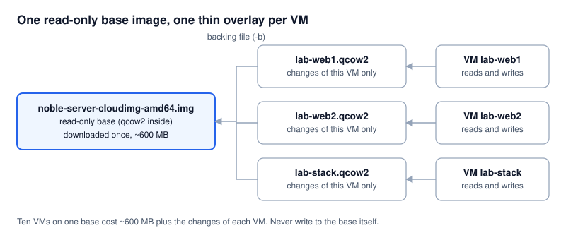
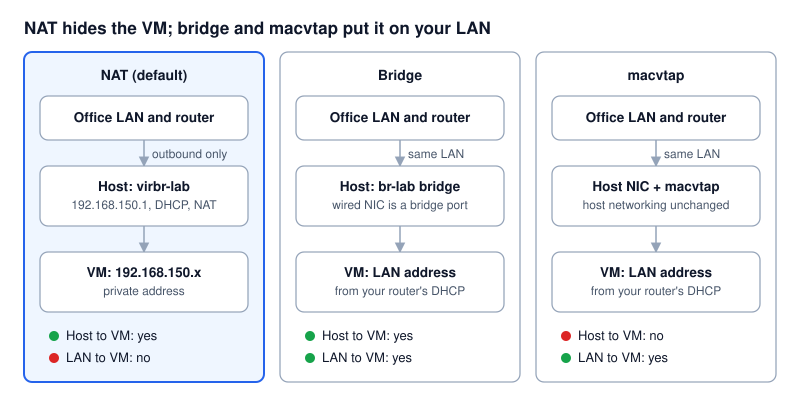
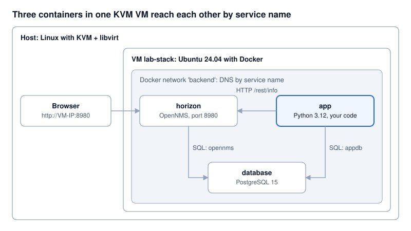

# KVM Lab tutorial

Read a section, then run the matching step. Every command of `kvm-lab.sh`
prints what it does and why before running it. Back to the [README](../README.md).

1. [Setup and install KVM](#1-setup-and-install-kvm)
2. [Disk images: .qcow2, .img, qemu-img](#2-disk-images-qcow2-img-qemu-img)
3. [Installing Ubuntu, CentOS and others](#3-installing-ubuntu-centos-and-others)
4. [Networking modes](#4-networking-modes)
5. [Containers: OpenNMS, PostgreSQL and Python](#5-containers-opennms-postgresql-and-python)
6. [Cleanup, troubleshooting and cheat sheet](#6-cleanup-troubleshooting-and-cheat-sheet)

Key words: **domain** = libvirt's word for a VM · **guest / host** = the VM /
the physical machine · **`qemu:///system`** = the system-wide libvirt daemon
(the lab always uses it) · **virtio** = fast paravirtual disk and network
drivers · **cloud-init** = configures a cloud image on first boot.

---

## 1. Setup and install KVM

### Step 1: check the host (read-only)

```bash
./kvm-lab.sh check
```

| Check | Manual command | Good result |
| --- | --- | --- |
| CPU supports virtualisation | `grep -Ec '(vmx\|svm)' /proc/cpuinfo` | Above 0 (`vmx` = Intel, `svm` = AMD). 0 = off in BIOS/UEFI |
| KVM device | `ls -l /dev/kvm` | Exists after install |
| Running inside a VM? | `systemd-detect-virt` | `none` (otherwise nested virtualisation is needed) |
| RAM and disk | `free -h`, `df -h /var` | 8 GB+ RAM, 30 GB+ free |
| VirtualBox active | `lsmod \| grep vboxdrv` | Not running while KVM VMs run |
| Network interface | `ip route show default` | Wired, if you want bridge mode |

### Step 2: install

```bash
./kvm-lab.sh install          # add --gui to also get virt-manager
```

What happens, in order:

1. **Packages.** Ubuntu/Debian: `qemu-system-x86 qemu-utils libvirt-daemon-system libvirt-clients virtinst dnsmasq-base`.
   Fedora/RHEL family: `qemu-kvm qemu-img libvirt virt-install`. The new packages are recorded in
   `~/kvm-lab/state/packages-installed-by-lab.txt` for cleanup.
2. **Daemon.** `systemctl enable --now libvirtd` and `modprobe kvm_intel` (or `kvm_amd`), which creates `/dev/kvm`.
3. **Storage pool `lab-pool`** = `/var/lib/libvirt/images/kvm-lab`, for all lab disks:
   `virsh pool-define-as lab-pool dir --target ...`, then `pool-build`, `pool-start`, `pool-autostart`.
4. **NAT network `lab-nat`** = 192.168.150.0/24 with DHCP, defined from a small XML file (`virsh net-define`).
5. **macvtap network `lab-macvtap`**: puts VMs on your LAN without changing host networking.
6. **SSH key** `~/kvm-lab/ssh/id_ed25519`, injected into every VM by cloud-init.

Verify:

```bash
sudo virsh -c qemu:///system net-list --all     # lab-nat active
sudo virsh -c qemu:///system pool-list --all    # lab-pool active
```

**Optional: virsh without sudo.** `sudo usermod -aG libvirt $USER`, log out and in, and
`export LIBVIRT_DEFAULT_URI=qemu:///system`. The lab does not do this for you; undo it with
`sudo gpasswd -d $USER libvirt`.

---

## 2. Disk images: .qcow2, .img, qemu-img

A VM's hard disk is a file on the host. **The file extension does not decide the
format; `qemu-img info` does.**

| Name | What it is | Key facts |
| --- | --- | --- |
| **`.qcow2`** | QEMU Copy-On-Write v2, KVM's native format | Grows as data is written; snapshots, compression, backing files (overlays). Default choice |
| **`.img`** | A naming convention, usually a **raw** disk | Plain byte-for-byte copy; simple, no snapshots. Some `.img` files are really qcow2 |
| **`qemu-img`** | The disk image tool (package `qemu-utils` / `qemu-img`) | `create`, `info`, `convert`, `resize`, `snapshot`, `check` |
| **`noble-server-cloudimg-amd64.img`** | Ubuntu 24.04 LTS (Noble) **cloud image** for x86-64 | Ends in `.img` but is **qcow2** inside; ~600 MB pre-installed Ubuntu Server with cloud-init |
| `.vdi` / `.vmdk` | VirtualBox / VMware formats | Convert with `qemu-img convert` |
| `.iso` | An installer CD/DVD, not a disk | The classic install route (section 3) |

**Cloud image vs ISO.** An ISO boots an installer you click through, like in
VirtualBox. A cloud image is an already-installed disk: cloud-init gives it a user
and SSH key on first boot and it is ready in ~30 seconds.

**Backing files (overlays).** The downloaded image stays a read-only *base*;
each VM gets a thin qcow2 *overlay* that stores only its own changes.



### Hands-on: learn-images

```bash
./kvm-lab.sh learn-images       # works in ~/kvm-lab/scratch, no sudo, ~1 minute
```

```bash
qemu-img create -f qcow2 demo.qcow2 10G      # 10 GiB virtual, ~200 KiB on disk
qemu-img create -f raw   demo.img   10G      # ls shows 10G, du shows ~0 (sparse file)
qemu-img info demo.qcow2                      # virtual size vs disk size
qemu-img create -f qcow2 base.qcow2 2G
qemu-img create -f qcow2 -b $PWD/base.qcow2 -F qcow2 overlay.qcow2 20G
qemu-img info --backing-chain overlay.qcow2   # overlay -> base
qemu-img resize overlay.qcow2 +5G
qemu-img snapshot -c before-change overlay.qcow2 && qemu-img snapshot -l overlay.qcow2
qemu-img convert -f qcow2 -O vdi demo.qcow2 demo.vdi      # to VirtualBox format
qemu-img convert -f vdi -O qcow2 demo.vdi demo-back.qcow2 # and back
```

### Hands-on: the Ubuntu cloud image

```bash
./kvm-lab.sh download ubuntu24
```

Downloads `https://cloud-images.ubuntu.com/noble/current/noble-server-cloudimg-amd64.img`
into `/var/lib/libvirt/images/kvm-lab/base/` and runs `qemu-img info` on it: look for
`file format: qcow2`. The manual version of what `create` then does:

```bash
sudo qemu-img create -f qcow2 -F qcow2 \
  -b /var/lib/libvirt/images/kvm-lab/base/noble-server-cloudimg-amd64.img \
  /var/lib/libvirt/images/kvm-lab/lab-web1.qcow2 20G
```

Never boot a VM directly from a base image: every overlay built on it would break.

**Bringing a VirtualBox VM over:**
`qemu-img convert -p -f vdi -O qcow2 old.vdi old.qcow2`, copy it into
`/var/lib/libvirt/images/kvm-lab/`, then `virt-install --import --disk path=...`.
For container hosts it is usually cleaner to rebuild from a cloud image (section 5).

---

## 3. Installing Ubuntu, CentOS and others

```bash
./kvm-lab.sh create <name> [image] [nat|bridge|macvtap] [ram-MB] [cpus] [disk-GB]

./kvm-lab.sh create web1                          # Ubuntu 24.04, NAT, 2 GB, 2 vCPU, 20 GB
./kvm-lab.sh create db1 centos9 nat 4096 2 40     # CentOS Stream 9
./kvm-lab.sh create mon1 rocky9
./kvm-lab.sh ssh web1                             # log in as user 'lab'
./kvm-lab.sh console web1                         # serial console: lab / lab, exit Ctrl+]
```

Names get a `lab-` prefix automatically (`web1` -> `lab-web1`) so cleanup can find them.

| Image | Distribution | Notes |
| --- | --- | --- |
| `ubuntu24` | Ubuntu 24.04 LTS (Noble) | Default |
| `ubuntu22` | Ubuntu 22.04 LTS (Jammy) | |
| `debian12` | Debian 12 (Bookworm) | |
| `centos9` | CentOS Stream 9 | Upstream of RHEL 9 |
| `centos10` | CentOS Stream 10 | Needs an x86-64-v3 CPU |
| `alma9` | AlmaLinux 9 | Free RHEL 9 rebuild |
| `rocky9` | Rocky Linux 9 | Free RHEL 9 rebuild |

CentOS Linux 7 and 8 are end-of-life. AlmaLinux and Rocky Linux are the usual
replacements for production; CentOS Stream is a preview of the next RHEL.

**What `create` does**

1. Downloads the image once (`./kvm-lab.sh download <image>`).
2. Creates a thin overlay disk on top of it.
3. Writes cloud-init `user-data` (hostname, user `lab` with sudo + your lab SSH key,
   console password `lab`, `qemu-guest-agent`) and `meta-data` to `~/kvm-lab/vms/<vm>/`.
4. Boots it with `virt-install`:

```bash
sudo virt-install --connect qemu:///system --name lab-web1 \
  --memory 2048 --vcpus 2 --cpu host-passthrough \
  --osinfo ubuntu24.04 --import \
  --disk path=/var/lib/libvirt/images/kvm-lab/lab-web1.qcow2,format=qcow2,bus=virtio \
  --network network=lab-nat,model=virtio \
  --graphics none --console pty,target_type=serial \
  --cloud-init user-data=user-data,meta-data=meta-data \
  --noautoconsole
```

5. Waits for an IP: `virsh domifaddr lab-web1` (DHCP lease) or `--source agent`.

| Option | Meaning |
| --- | --- |
| `--import` | Boot the existing disk, skip any installer |
| `--cpu host-passthrough` | Give the guest the real CPU model (fastest) |
| `--osinfo` | Tell libvirt the guest OS so it picks good defaults |
| `bus=virtio`, `model=virtio` | Fast paravirtual disk and NIC |
| `--graphics none` + serial console | Headless VM, reachable with `virsh console` |
| `--cloud-init` | Attach a small config disk for the first boot |

**Day-to-day**

| Action | Lab command | Plain virsh |
| --- | --- | --- |
| List VMs, IPs, networks | `./kvm-lab.sh list` | `virsh list --all`, `virsh net-list` |
| Stop / start | `./kvm-lab.sh stop web1` / `start web1` | `virsh shutdown` / `virsh start` |
| Snapshot / revert | `./kvm-lab.sh snapshot web1 clean` / `revert web1 clean` | `virsh snapshot-create-as` / `snapshot-revert` |
| See the VM as a host process | `./kvm-lab.sh inspect web1` | `ps -T -p <pid>`, `virsh vcpuinfo` |
| Delete VM + disk | `./kvm-lab.sh delete web1` | `virsh undefine lab-web1 --remove-all-storage` |
| More RAM (VM off) | | `virt-xml lab-web1 --edit --memory 4096` |

**The classic ISO route.** For a desktop OS or a distro without a cloud image:
`./kvm-lab.sh install --gui`, then virt-manager: *File > New Virtual Machine >
Local install media*. Or:

```bash
sudo virt-install --connect qemu:///system --name lab-desk1 \
  --memory 4096 --vcpus 2 --osinfo ubuntu24.04 \
  --cdrom ~/Downloads/ubuntu-24.04-desktop-amd64.iso \
  --disk pool=lab-pool,size=30,format=qcow2 \
  --network network=lab-nat --graphics spice
```

Keep the `lab-` prefix and `lab-pool` so cleanup removes it too.

---

## 4. Networking modes

Start on NAT; switch to bridge only when other machines on your LAN must reach
the VM directly.



| Mode | Lab network | VM gets | Host to VM | LAN to VM | Host changes |
| --- | --- | --- | --- | --- | --- |
| **NAT** (default) | `lab-nat` | 192.168.150.x | Yes | No (port forward / SSH tunnel) | None |
| **Bridge** | `lab-bridge` on `br-lab` | LAN IP from your router | Yes | Yes | Wired NIC becomes a bridge port |
| **macvtap** | `lab-macvtap` | LAN IP from your router | **No** | Yes | None |

```bash
./kvm-lab.sh create web2 ubuntu24 macvtap     # choose at create time
./kvm-lab.sh net web1 macvtap                 # or switch later
./kvm-lab.sh net web1 nat
```

Switching runs `virt-xml lab-web1 --edit --network network=<net>`: same MAC and
slot, only the network changes; the VM is restarted to get a new IP.

### Real bridge (optional, changes host networking)

```bash
./kvm-lab.sh hostbridge on     # wired NIC + NetworkManager only
./kvm-lab.sh net web1 bridge
./kvm-lab.sh hostbridge off
```

Under the hood:

```bash
nmcli con add type bridge ifname br-lab con-name br-lab bridge.stp no \
  bridge.mac-address <your NIC's MAC> connection.autoconnect no ipv4.method auto
nmcli con add type bridge-slave ifname enp3s0 master br-lab con-name br-lab-port connection.autoconnect no
nmcli con up br-lab-port
```

The bridge copies your NIC's MAC, so the router usually gives the host the same IP.
It is not autoconnect, so a reboot returns the host to its original connection.

Limits: Wi-Fi cannot be bridged (use NAT or macvtap). Servers using netplan +
systemd-networkd need a netplan bridge instead. Some corporate switch ports
allow only one MAC address, which blocks bridge and macvtap.

---

## 5. Containers: OpenNMS, PostgreSQL and Python

KVM replaces VirtualBox as the machine layer; your container workflow inside
the VM stays the same.

```bash
./kvm-lab.sh stack          # NAT: reach it from this host
./kvm-lab.sh stack bridge   # on your LAN (after 'hostbridge on')
```



What it does:

1. Creates VM `lab-stack` (6 GB RAM, 2 vCPU, 30 GB). cloud-init installs `docker.io` and `docker-compose-v2`.
2. Generates `~/kvm-lab/stack/` on the host: `compose.yaml`, `app/Dockerfile`, `app/app.py`.
3. Copies it to the VM and runs `sudo docker compose up -d --build`.
4. OpenNMS UI: `http://<vm-ip>:8980/opennms` (`admin` / `admin`, change it). First start: 3-5 minutes.

All three containers join the Docker network `backend`; Docker's DNS resolves
each **service name**, so the app uses `database:5432` and
`http://horizon:8980/opennms` with no hard-coded IPs.

| Service | Image | Talks to | Exposed |
| --- | --- | --- | --- |
| `database` | `postgres:15` | - | Only inside `backend` |
| `horizon` | `opennms/horizon:latest` (pin a version for real use) | `database` (DB `opennms`) | Port 8980 on the VM |
| `app` | built from `app/Dockerfile` (Python 3.12) | `horizon` (HTTP), `database` (DB `appdb`) | Nothing |

```yaml
services:
  database:
    image: postgres:15
    environment: {POSTGRES_USER: postgres, POSTGRES_PASSWORD: postgres, POSTGRES_DB: appdb}
    healthcheck: {test: ["CMD-SHELL", "pg_isready -U postgres"], interval: 10s, retries: 10}
  horizon:
    image: opennms/horizon:latest
    command: ["-s"]                       # initialise schema, then start
    depends_on: {database: {condition: service_healthy}}
    environment:
      POSTGRES_HOST: database             # service name = host name
      POSTGRES_USER: postgres
      POSTGRES_PASSWORD: postgres
      OPENNMS_DBNAME: opennms
      OPENNMS_DBUSER: opennms
      OPENNMS_DBPASS: opennms
    ports: ["8980:8980"]
  app:
    build: ./app
    environment:
      DB_HOST: database
      OPENNMS_URL: http://horizon:8980/opennms
```

Every 30 seconds the Python app calls OpenNMS `/rest/info` and stores the
result in table `checks` in `appdb`, proving all three connections work.

```bash
./kvm-lab.sh ssh stack 'cd stack && sudo docker compose ps'
./kvm-lab.sh ssh stack 'cd stack && sudo docker compose logs -f app'
./kvm-lab.sh ssh stack "cd stack && sudo docker compose exec database psql -U postgres -d appdb -c 'select * from checks order by id desc limit 5'"
```

**Make it yours**

- Replace `~/kvm-lab/stack/app/app.py` with your scripts, `scp` the folder again and `docker compose up -d --build`.
  Copy it outside `~/kvm-lab` first if you want to keep it after cleanup.
- Add a service on network `backend`; it reaches the others by name.
- Podman on RHEL-family VMs: `./kvm-lab.sh create stack2 alma9`, then `sudo dnf install -y podman podman-compose` (EPEL).
- Reach OpenNMS from elsewhere: `stack bridge`, or `ssh -L 8980:localhost:8980 lab@<vm-ip>`.
- One VM per role (DB VM, OpenNMS VM) also works: same lab network, VM IPs instead of service names.

---

## 6. Cleanup, troubleshooting and cheat sheet

### Cleanup

```bash
./kvm-cleanup.sh
```

It removes every `lab-*` VM (with disks and snapshots), every `lab-*` network
and the `br-lab` bridge (restoring your original connection), `lab-pool` and its
directory, the packages the lab installed (showing anything extra first),
libvirt directories that did not exist before, the KVM modules, and `~/kvm-lab`.
Then it verifies and prints **Host is clean**. If libvirt was installed before
the lab, the packages are left alone automatically. The system users/groups the
packages created (`libvirt-qemu`, `libvirt`) are harmless and left behind.

### Troubleshooting

| Symptom | Cause | Fix |
| --- | --- | --- |
| No vmx/svm flag | Virtualisation off in BIOS/UEFI | Enable Intel VT-x / AMD-V (SVM) |
| VirtualBox: `VERR_VMX_IN_VMX_ROOT_MODE` | KVM holds VT-x | Stop KVM VMs; `sudo modprobe -r kvm_intel kvm`, or run cleanup |
| VM has no IP | Still booting / cloud-init running | Wait; `./kvm-lab.sh console web1` (lab / lab) |
| SSH fails to a macvtap VM | Host cannot reach macvtap VMs by design | Use NAT/bridge, or SSH from another LAN machine |
| Bridged VM gets no IP while Docker runs on the host | Host Docker sets iptables FORWARD to DROP | `sudo iptables -I FORWARD -i br-lab -o br-lab -j ACCEPT` |
| `Permission denied` on a disk | Disk outside libvirt dirs (AppArmor/SELinux) | Keep disks under `/var/lib/libvirt/images` |
| CentOS Stream 10 kernel panic | CPU older than x86-64-v3 | Use `centos9`, `alma9` or `rocky9` |
| OpenNMS page not loading | Still starting, or low RAM | `docker compose logs -f horizon`; give the VM more RAM |
| Install stops on subnet clash | LAN/VPN uses 192.168.150.0/24 | `LAB_SUBNET=192.168.151 ./kvm-lab.sh install` |

### Cheat sheet

Add `-c qemu:///system` (or set `LIBVIRT_DEFAULT_URI`) and `sudo` unless you are in the `libvirt` group.

```bash
virsh list --all                       # VMs
virsh start | shutdown | reboot | destroy VM
virsh console VM                       # serial console, exit Ctrl+]
virsh domifaddr VM                     # IP address
virsh dumpxml VM                       # full config as XML
virsh edit VM                          # edit config
virsh autostart VM                     # start with the host
virsh snapshot-create-as VM NAME ; virsh snapshot-list VM ; virsh snapshot-revert VM NAME
virsh undefine VM --remove-all-storage
virsh net-list --all ; virsh net-dumpxml lab-nat ; virsh net-dhcp-leases lab-nat
virsh pool-list --all ; virsh vol-list lab-pool
qemu-img info DISK ; qemu-img convert -f vdi -O qcow2 IN OUT ; qemu-img resize DISK +10G
```

### Sources

- [Ubuntu 24.04 cloud images](https://cloud-images.ubuntu.com/noble/current/)
- [CentOS Stream 9 cloud images](https://cloud.centos.org/centos/9-stream/x86_64/images/)
- [Rocky Linux 9 images](https://dl.rockylinux.org/pub/rocky/9/images/x86_64/)
- [OpenNMS Horizon Core Docker reference](https://docs.opennms.com/horizon/34/reference/configuration/core-docker.html)
- [libvirt documentation](https://libvirt.org/docs.html)
- [cloud-init documentation](https://cloudinit.readthedocs.io/)
