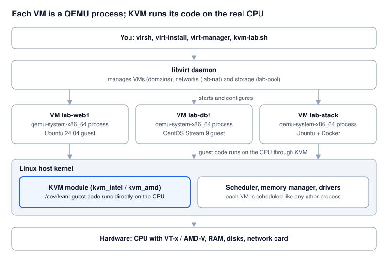
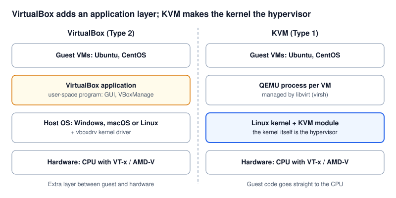
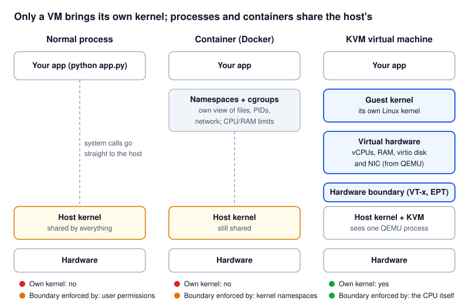
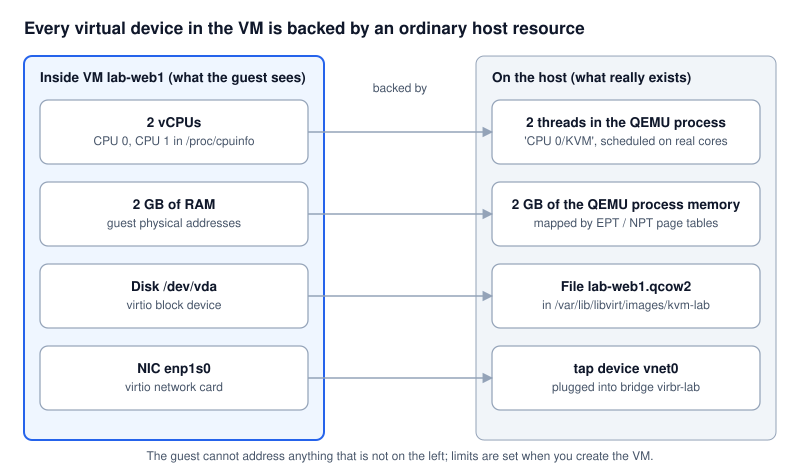
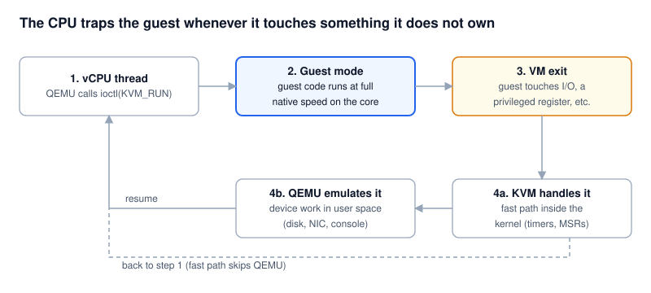

# KVM Lab: from VirtualBox to KVM

A hands-on lab and tutorial for developers moving from **VirtualBox** to **KVM**.
You go from an empty Linux host to Ubuntu and CentOS VMs, three network modes,
and a VM running **OpenNMS + PostgreSQL + your Python app** in containers that
talk to each other. Then one command puts your host back exactly as it was.

Everything runs from **two files**:

| File | What it does |
| --- | --- |
| [`kvm-lab.sh`](kvm-lab.sh) | Every setup and learning step as a sub-command (`check`, `install`, `create`, `net`, `inspect`, `stack`, ...). Prints each command and a short explanation before running it. |
| [`kvm-cleanup.sh`](kvm-cleanup.sh) | Removes everything the lab created, including the packages it installed, and verifies the host is clean. |

```bash
git clone https://github.com/<you>/kvm-lab.git && cd kvm-lab
chmod +x kvm-lab.sh kvm-cleanup.sh
./kvm-lab.sh help        # list every step
./kvm-lab.sh tour        # guided: check -> install -> learn-images -> first VM
./kvm-lab.sh stack       # OpenNMS + PostgreSQL + Python app in a VM
./kvm-cleanup.sh         # undo everything
```

Run the scripts as your normal user (not with `sudo`); they call `sudo` themselves.

---

## Contents

1. [What is KVM?](#1-what-is-kvm)
2. [VirtualBox vs KVM](#2-virtualbox-vs-kvm)
3. [How a VM differs from a normal OS process](#3-how-a-vm-differs-from-a-normal-os-process)
4. [Safety: the lab is a sandbox](#4-safety-the-lab-is-a-sandbox)
5. [Tutorial steps](#5-tutorial-steps)
6. [Requirements](#6-requirements)
7. [Repository layout](#7-repository-layout)

Full step-by-step tutorial: **[docs/TUTORIAL.md](docs/TUTORIAL.md)** ·
Deep dive on isolation: **[docs/HOW-VMS-WORK.md](docs/HOW-VMS-WORK.md)**

---

## 1. What is KVM?

**KVM (Kernel-based Virtual Machine)** is a module in the Linux kernel that turns
Linux itself into a hypervisor. Four pieces work together:

| Piece | Role | You use it through |
| --- | --- | --- |
| **KVM** (`kvm_intel` / `kvm_amd`) | Runs guest CPU instructions directly on the physical CPU, using Intel VT-x / AMD-V | `/dev/kvm` |
| **QEMU** | Emulates the rest of a PC: disks, network cards, firmware, console. One `qemu-system-x86_64` process per VM | `qemu-img` |
| **libvirt** | Daemon that manages VMs, networks and storage; stores each VM as XML | `virsh`, `virt-install`, `virt-xml` |
| **virt-manager** (optional) | Desktop GUI, the closest thing to the VirtualBox window | `virt-manager` |



---

## 2. VirtualBox vs KVM

VirtualBox is an **application** (plus its own kernel driver) running on top of a
host OS: a **Type 2** hypervisor. KVM is **part of the Linux kernel**, so the
host OS *is* the hypervisor, which is why it is usually called **Type 1**. It is
the same technology behind most public clouds, OpenStack and Proxmox.



| | VirtualBox | KVM + libvirt |
| --- | --- | --- |
| Hypervisor type | Type 2: app + `vboxdrv` driver on a host OS | Built into the Linux kernel (Type 1 in practice) |
| Host OS | Windows, macOS, Linux | Linux only |
| Typical use | Desktops, demos | Servers, clouds, CI, labs |
| Default disk format | `.vdi` | `.qcow2` (or raw `.img`) |
| Main CLI | `VBoxManage` | `virsh`, `virt-install`, `qemu-img` |
| GUI | VirtualBox Manager | virt-manager, Cockpit (web) |
| Headless servers | Possible, not its focus | The normal case |
| Kernel updates | `vboxdrv` must be rebuilt | Nothing extra: KVM ships with the kernel |
| Licence | GPLv2 core; Extension Pack under a separate commercial licence | Fully open source (GPL/LGPL) |

**The same task in both tools**

| Task | VirtualBox | KVM |
| --- | --- | --- |
| List VMs | `VBoxManage list vms` | `virsh list --all` |
| Start / stop | `VBoxManage startvm web1 --type headless` / `controlvm web1 acpipowerbutton` | `virsh start web1` / `virsh shutdown web1` |
| Force off | `VBoxManage controlvm web1 poweroff` | `virsh destroy web1` (deletes nothing) |
| Snapshot | `VBoxManage snapshot web1 take s1` | `virsh snapshot-create-as web1 s1` |
| Show config | `VBoxManage showvminfo web1` | `virsh dumpxml web1` |
| Delete VM + disk | `VBoxManage unregistervm web1 --delete` | `virsh undefine web1 --remove-all-storage` |
| Convert a disk | `VBoxManage clonemedium a.vdi b.vmdk` | `qemu-img convert -f vdi -O qcow2 a.vdi a.qcow2` |

| Network mode | VirtualBox name | KVM / libvirt |
| --- | --- | --- |
| VM hidden behind the host | NAT / NAT Network | NAT network (`lab-nat`) |
| VM on the LAN with its own IP | Bridged Adapter | Bridge (`br-lab`) or macvtap |
| VMs only talk to each other | Internal Network | Isolated network |

> **Do not run VirtualBox VMs and KVM VMs at the same time.** Both need
> exclusive use of the CPU's virtualisation extensions. `kvm-cleanup.sh`
> unloads the KVM modules so VirtualBox works again without a reboot.

---

## 3. How a VM differs from a normal OS process

From the host's point of view **a KVM virtual machine is an ordinary process**:
you can see it in `ps`, kill it, and limit it like any other. What makes it
different is *what runs inside it* and *who enforces its walls*.



| | Normal process | Container | KVM virtual machine |
| --- | --- | --- | --- |
| Kernel | Host kernel | Host kernel (shared) | **Its own guest kernel** |
| Sees | Real host files, PIDs, network (as allowed by permissions) | Filtered view through namespaces | Only its own virtual hardware |
| Talks to the host by | System calls | System calls (filtered) | **No system calls into the host**: only virtual hardware, trapped by the CPU |
| Walls enforced by | User permissions | Kernel namespaces + cgroups | **The CPU itself** (VT-x / AMD-V, EPT / NPT) + the host kernel |
| Can run another OS | No | No (same kernel) | Yes: Linux, Windows, BSD |
| A kernel crash affects | Whole host | Whole host | Only that VM |
| Start time / overhead | Instant / none | ~1 s / tiny | ~10-30 s / one guest kernel + its RAM |

### How the safe environment is built

A VM gets its own "hardware", but every piece is backed by an ordinary host
resource that the host kernel controls:



- **CPU.** Each virtual CPU is a **thread** of the QEMU process (named `CPU 0/KVM`).
  When the thread calls `ioctl(KVM_RUN)`, the physical core switches into
  **guest mode** and runs guest code at native speed. The host scheduler decides
  when and on which core that thread runs, exactly as for any thread.
- **Memory.** Guest RAM is a block of the QEMU process's memory. The CPU uses
  a second set of page tables (**EPT** on Intel, **NPT** on AMD) that maps
  "guest physical" addresses only onto that block. The guest has no address it
  could use to reach host memory or another VM.
- **Disk.** The guest sees a disk `/dev/vda`; on the host it is just a file
  (`lab-web1.qcow2`). The guest can only change what is in that file.
- **Network.** The guest sees a network card; on the host it is a `tap`
  device plugged into a virtual switch (`virbr-lab`), where NAT or bridge rules apply.
- **Trapping.** Whenever the guest touches something it does not own (a device
  register, I/O port, certain privileged CPU state), the CPU forces a
  **VM exit** back to KVM. KVM either handles it in the kernel or hands it to QEMU,
  which emulates the device, and then resumes the guest.



**Extra walls around the QEMU process** (set up by libvirt):

| Layer | What it does |
| --- | --- |
| Unprivileged user | QEMU runs as `libvirt-qemu` (Ubuntu) or `qemu` (RHEL/Fedora), not root |
| sVirt: AppArmor / SELinux | Each VM's QEMU process gets its own profile or label, so it can only open its own disk files |
| cgroups | Each VM lives in its own cgroup (`machine.slice`), so CPU weight, memory and I/O can be limited per VM |
| Fixed resources | vCPU count, RAM size, disk size and NICs are set in the VM definition; the guest cannot grow them |

**See it yourself** on a running lab VM:

```bash
./kvm-lab.sh create web1
./kvm-lab.sh inspect web1     # the QEMU process, its vCPU threads, RAM, disk file, tap device,
                              # and the same VM from the inside (nproc, free, lsblk)
```

**Honest limits.** VM isolation is much stronger than a container's because a
bug inside the guest, including a guest kernel crash, stays inside the guest.
It is not absolute: a bug in KVM or QEMU itself could in principle be used to
escape, which is why hosts are kept patched and QEMU is confined as above.
Also, VMs share the host's physical CPU and RAM, so an overloaded host slows
every VM.

More detail, including memory overcommit, the guest agent and device
passthrough: [docs/HOW-VMS-WORK.md](docs/HOW-VMS-WORK.md).

---

## 4. Safety: the lab is a sandbox

`./kvm-cleanup.sh` returns the host to its original state. The lab makes that
possible by following a few rules:

- Every VM, network and storage pool it creates is named **`lab-*`**.
- All VM disks live in **`/var/lib/libvirt/images/kvm-lab`**.
- All your files (SSH key, cloud-init, scratch disks, state) live in **`~/kvm-lab`**.
  Your `~/.ssh` is never touched.
- At install time it records **exactly which packages were new**; cleanup removes only those.
- It uses its own NAT network `lab-nat` (192.168.150.0/24); libvirt's `default` network is left alone.

| Risk | When | Protection |
| --- | --- | --- |
| Host loses network | Only `hostbridge on` (optional real bridge) | Refuses on Wi-Fi and over SSH; auto-rollback if no IP in 45 s; not autoconnect, so **a reboot restores your network** |
| VirtualBox stops working | KVM modules loaded | Warned in `check`; cleanup unloads them |
| Disk fills up | Many VMs, OpenNMS images | `check` warns below 30 GB; VMs use thin overlays |
| Subnet clash | Your LAN/VPN uses 192.168.150.0/24 | Install stops; use `LAB_SUBNET=192.168.151` |
| Removing a package you now need | Software you installed later depends on it | Cleanup simulates first and asks |

```bash
./kvm-cleanup.sh                  # asks before removing packages
./kvm-cleanup.sh --yes            # no questions
./kvm-cleanup.sh --keep-packages  # keep KVM installed, remove only lab VMs/networks/files
```

For an even stronger sandbox, run the whole lab on a spare machine or a cloud VM
with nested virtualisation.

---

## 5. Tutorial steps

| # | Topic | Command | Tutorial |
| --- | --- | --- | --- |
| 1 | Check the host | `./kvm-lab.sh check` | [Setup](docs/TUTORIAL.md#1-setup-and-install-kvm) |
| 2 | Install KVM + sandbox | `./kvm-lab.sh install [--gui]` | [Setup](docs/TUTORIAL.md#1-setup-and-install-kvm) |
| 3 | Disk images: `.qcow2`, `.img`, `qemu-img` | `./kvm-lab.sh learn-images` | [Disk images](docs/TUTORIAL.md#2-disk-images-qcow2-img-qemu-img) |
| 4 | Ubuntu, CentOS Stream, Alma, Rocky, Debian VMs | `./kvm-lab.sh create web1 ubuntu24` | [Operating systems](docs/TUTORIAL.md#3-installing-ubuntu-centos-and-others) |
| 5 | A VM seen as a process | `./kvm-lab.sh inspect web1` | [How VMs work](docs/HOW-VMS-WORK.md) |
| 6 | NAT, bridge, macvtap | `./kvm-lab.sh net web1 macvtap` | [Networking](docs/TUTORIAL.md#4-networking-modes) |
| 7 | OpenNMS + PostgreSQL + Python containers | `./kvm-lab.sh stack` | [Containers](docs/TUTORIAL.md#5-containers-opennms-postgresql-and-python) |
| 8 | Clean up | `./kvm-cleanup.sh` | [Cleanup](docs/TUTORIAL.md#6-cleanup-troubleshooting-and-cheat-sheet) |

---

## 6. Requirements

- x86-64 Linux host: Ubuntu 22.04 / 24.04, Debian 12, Fedora, or RHEL / AlmaLinux / Rocky 9
- Intel VT-x or AMD-V enabled in BIOS/UEFI (`./kvm-lab.sh check` tells you)
- 8 GB RAM (16 GB for the OpenNMS stack), 30 GB free disk
- `sudo` rights and internet access
- Optional, for bridge mode: a wired network card and NetworkManager

---

## 7. Repository layout

```
kvm-lab/
├── README.md               this page
├── kvm-lab.sh              file 1: every setup and learning step
├── kvm-cleanup.sh          file 2: one-command reset
├── docs/
│   ├── TUTORIAL.md         full step-by-step tutorial
│   └── HOW-VMS-WORK.md     deep dive: isolation, CPU, memory, devices
├── images/                 SVG diagrams used in the docs
├── .github/workflows/
│   └── shellcheck.yml      lints the scripts on every push
├── .gitignore
└── LICENSE                 MIT
```

## License

[MIT](LICENSE). Images are original diagrams made for this repository.
